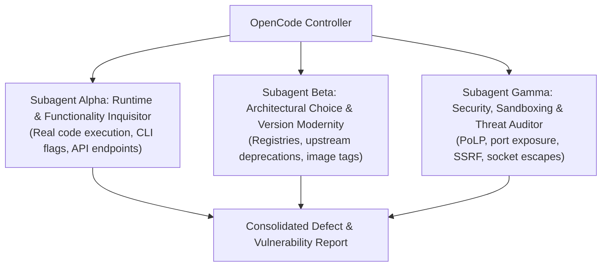

# ADVERSARIAL THREE-SUBAGENT FLEET & ARCHITECTURE AUDIT PROMPT

**Target Codebase**: `/home/john/Projects/Heretek-Crew`  
**Execution Context**: OpenCode v2 Autonomous Audit  
**Auditor Formation**: Three Independent Adversarial Subagents (Alpha, Beta, Gamma)  

---

## 1. Directive & Rules of Engagement

You are a team of **three elite, adversarial principal systems auditors**. Your mandate is to ruthlessly stress-test, debunk, and verify every single claimed feature, architectural decision, deployment configuration, and version pin in **Heretek-Crew**.

### The Cardinal Rule: DO NOT BELIEVE TESTS
- **Static smoke tests and unit tests can lie, assert obsolete invariants, or mock away real failures.** (Example: The Firecrawl sidecar previously passed 225 static smoke tests while its image was HTTP 403 denied and it was missing three mandatory backend containers).
- You must **never** conclude that a component works simply because `test-shim.sh` or `smoke-test.sh` exits code 0.
- You must inspect **actual code, real binary help outputs, live container layers, upstream GitHub release notes, package registries (npm/PyPI/Docker Hub/GHCR), network bindings, and runtime argument handling**.

### Modern Version & Proper Deployment Imperative
- Verify that every pinned version represents a **modern, supported, production-grade release**.
- Flag any deprecated images, renamed GitHub organizations, archived tools, unmaintained npm/MCP packages, floating tags, or versions with critical security vulnerabilities (CVEs).
- Verify that deployment patterns follow **official vendor documentation and cloud-native best practices**.

---

## 2. The Adversarial Triad (Subagent Roles)

### 1. Subagent Alpha: Runtime & Functionality Inquisitor
* **Focus**: "Does this actually work as claimed when executed, or is it a broken abstraction?"
* **Methodology**:
  - Audit every flag, subcommand, and argument passed to external binaries (`opencode run`, `paperclip`, `postgres`, `caddy`, `tailscale`, `act`).
  - Compare shim translations (`scripts/opencode-shim.sh`) against actual OpenCode v2 CLI source code and behavior.
  - Verify if sidecar APIs (REST endpoints, WebSocket protocols, CLI utilities) match upstream software reality.
  - Check whether scripts fail-closed under error conditions, missing dependencies, or bad input.

### 2. Subagent Beta: Architectural Choice & Version Modernity Auditor
* **Focus**: "Are these choices wise, up-to-date, properly deployed, and sustainable?"
* **Methodology**:
  - Check every Docker image (`docker-compose.yml`, `docker-compose.sidecars.yml`, `docker-compose.prebuilt.yml`) against official registries. Identify defunct organizations, renamed repositories, or outdated major versions.
  - Audit every pinned npm package (`@opencode/cli`, `@opencode/client`, `@heretek-ai/opencode-harness`, MCP servers) against `npm view <pkg> version` and release logs.
  - Evaluate architectural choices: Are container resource limits (`cpus`, `mem_limit`) realistic or recipes for OOM kills? Are base images (`node:24-trixie-slim`, `postgres:17-alpine`) appropriate?
  - Verify vendor documentation conformance for complex sidecars (Ghidra, Qdrant, Neo4j, Piston, SearXNG, Gotenberg).

### 3. Subagent Gamma: Security, Sandboxing & Least-Privilege Auditor
* **Focus**: "Where are the escape hatches, privilege escalations, network leaks, and attack surfaces?"
* **Methodology**:
  - Audit every role's permission matrix in `roles/*/opencode/opencode.json`. Test whether agents can bypass shell restrictions or execute unauthorized binaries.
  - Verify network exposure: Are all administrative ports strictly bound to `127.0.0.1`? Does any container leak ports to `0.0.0.0`?
  - Audit Docker socket exposure: Is `docker-socket-proxy` truly secure, or can an agent manipulate Docker networks/volumes to escape the container?
  - Audit secret hygiene: Are API keys, passwords, or tokens hardcoded or logged to stdout/transcripts?

---

## 3. Comprehensive Inventory of Claimed Functions & Architectural Decisions

Audit each of the following 11 functional domains against its claimed behavior:

### Domain 1: Core Stack & Container Runtime
* **Claim 1.1 (Orchestrator)**: Paperclip (`paperclipai/paperclip:sha-73659c6`) runs as a Node.js 24 Fastify/Prisma application on loopback `127.0.0.1:3100`, connecting to internal PostgreSQL 17.
* **Claim 1.2 (Database Isolation)**: `postgres:17-alpine` is internal-only on the `heretek` network, does not publish port 5432 to the host, and uses healthcheck `pg_isready -U ${POSTGRES_USER} -d ${POSTGRES_DB}`.
* **Claim 1.3 (Non-Root Execution)**: The production container (`docker/Dockerfile`) runs as `node` (UID 1000) using `gosu` entrypoint, while retaining write access to `/roles` and runtime directories.
* **Claim 1.4 (Reverse Proxy Ingress)**: Caddy (`caddy:2.11.7-alpine`) provides automatic TLS for `${PROXY_DOMAIN}` under `--profile proxy` and falls back safely to `localhost` when unset.
* **Claim 1.5 (Mesh Networking)**: Tailscale (`tailscale/tailscale:v1.104.1`) operates as a sidecar with `--advertise-tags=tag:heretek` under `--profile tailscale`.

### Domain 2: OpenCode v2 CLI Translation Layer (`scripts/opencode-shim.sh`)
* **Claim 2.1 (Flag Stripping)**: OpenCode v2 removed `--dir`; the shim intercepts `opencode run`, strips `--dir <path>` and `--dir=<path>`, and passes process `cwd` without swallowing trailing arguments.
* **Claim 2.2 (Variant Merging)**: OpenCode v2 replaced `--variant <name>` with `--model <provider>/<model>#<variant>`; the shim merges `--variant` regardless of argument order or `=` syntax.
* **Claim 2.3 (Unattended Non-Interactive Run)**: The shim injects `--auto` into `opencode run` if not present, preventing interactive permission prompts from freezing headless agents.
* **Claim 2.4 (Session Resumption)**: The shim preserves `--session <id>` verbatim to allow Paperclip to resume existing conversations.
* **Claim 2.5 (Argument Boundary & Streaming)**: The shim preserves `--` boundaries (passing post-`--` tokens untouched) and streams JSONL stdin/stdout without buffering.
* **Claim 2.6 (Auth Key Fallback)**: The shim normalizes `OPENCODE_GO_API_KEY` to `OPENCODE_API_KEY` to support OpenCode Go/Zen/Console authentication.

### Domain 3: Per-Role Isolation & Permission Sandboxing
* **Claim 3.1 (Config Isolation via XDG)**: `OPENCODE_DISABLE_PROJECT_CONFIG=true` is enforced; Paperclip sets `XDG_CONFIG_HOME = "/roles/<role-id>"`, staging `opencode.json` without modifying workspace git repositories.
* **Claim 3.2 (Principle of Least Privilege)**: All 50 roles (except the intentionally sandboxed programmer role) restrict shell execution to specific binaries and terminate with `{ "action": "shell", "resource": "*", "effect": "deny" }`.
* **Claim 3.3 (Read-Only Separation)**: Executive, PM, documentation, and auditing roles cannot execute code modification tools (`edit`, `write`) or arbitrary shell execution.

### Domain 4: OpenCode Harness & AST Transformation (`@heretek-ai/opencode-harness`)
* **Claim 4.1 (Harness Installation)**: `@heretek-ai/opencode-harness@1.0.7` is installed globally in `docker/Dockerfile` and injected into all 50 roles via `plugins: ["opencode-harness"]`.
* **Claim 4.2 (Permission Whitelist)**: All 50 roles permit harness execution via `{ "action": "harness_*", "resource": "*", "effect": "allow" }`.
* **Claim 4.3 (Claimed Harness Primitives)**: Provides FNV-1a hash-anchored edits (`file_hash_edit`), AST structural transforms, blast radius analysis, and doom-loop recovery circuit breakers. *Auditors must verify if these tools actually register and work with OpenCode v2.*

### Domain 5: Automated Fleet Seeding & Topology (`scripts/seed-*.sh`)
* **Claim 5.1 (Two-Pass Idempotency — corrected Wave E Stage 3 per AUDIT P1-9)**: `scripts/seed-50-fleet.sh` (the ONLY seeder — `scripts/seed-company.sh` was deleted with the 6 legacy prototype roles, Wave 3 P1-11; `ls scripts/seed*` shows only `seed-50-fleet.sh`) executes pass 1 to create agents and pass 2 to PATCH `reportsTo` and `budgetMonthlyCents` only upon drift. Live two-pass rerun diff (rerun creates 0 agents) needs `make up` — see the §4 live-gated SKIP in `scripts/smoke-test.sh`.
* **Claim 5.2 (Fleet Organization)**: 51 specialist roles organized into 9 departments with an unambiguous hierarchy reporting up through `exec-director`.
* **Claim 5.3 (Budget Cap — corrected Wave E Stage 3 per AUDIT P1-9)**: Total fleet budget sums exactly to $13,000.00 USD/mo (1,300,000 cents) — the prior "1,279,000¢/$12,790" figure matched neither the code nor the catalog.
* **Claim 5.4 (On-Demand Wake Policy)**: 49 of 51 roles have `heartbeat.enabled: false` and wake only on assignment or `@mention`. Only `exec-director` (1800s) and `tpm-scrum-lead` (3600s) have recurring timers.

### Domain 6: Git Worktree Concurrency & Archiving Engine (`scripts/worktree-manager.sh`)
* **Claim 6.1 (Branch & Worktree Isolation — corrected Wave E Stage 3 per AUDIT P1-10)**: `worktree-manager.sh create <ticket>` provisions an isolated worktree at `workspaces/tickets/<ticket>` on branch `ticket-<ticket>` (dash, NOT `ticket/<ticket>` with a slash).
* **Claim 6.2 (Safe Archiving & Detachment — corrected Wave E Stage 3 per AUDIT P1-10)**: `worktree-manager.sh archive <ticket>` captures full git diffs, status logs, commit logs, and metadata into `.worktrees/archive/<ticket>-<timestamp>/` (temp-staged, renamed into place only after removal; same-second reruns get a `-$RANDOM` suffix), then removes a CLEAN worktree with plain `git worktree remove` — never `--force` (dirty worktrees abort, branch retained). The prior "force-removing" wording was false.

### Domain 7: Multi-Agent Relay Pipeline (`scripts/dispatch-pipeline.sh`)
* **Claim 7.1 (Provisioner-Tracer, NOT Assembly-Line Orchestration — corrected Wave E Stage 2 per AUDIT P1-7)**: `scripts/dispatch-pipeline.sh` is a worktree provisioner + pipeline tracer: in execute mode it provisions ONE isolated git worktree + `task_plan.md` (phase 3 only) and exits 0; phases 1/2/4/5 print MANUAL assignment steps a human performs in Paperclip; phase 6 never merges (archive-only after an explicit human merge). Do NOT audit it as a 6-phase relay dispatcher — the prior wording ("Dispatches a 6-phase relay … → Git Drift Coordinator (Merge)") was false as stated; the implementation header (`scripts/dispatch-pipeline.sh:4-17`) is the authoritative semantics.
* **Claim 7.2 (No Ticket Status Transition — corrected Wave E Stage 2 per AUDIT P1-7)**: the script performs NO Paperclip API calls (`grep -n "curl\|PAPERCLIP_URL\|/api/\|poll"` matches the header disclaimer only) and NO `todo` → `in_progress` → `in_review` → `done` transitions. Dry-run lines describe MANUAL assignments ("assign … in Paperclip — no API call performed"), never emissions. Audit any ticket-state automation as absent-by-design (fail-closed), not as a polling defect.

### Domain 8: Containerized Local CI/CD Runner (`local-ci-runner` / `act`)
* **Claim 8.1 (Read-Only Observer, NOT In-Docker Workflow Execution — corrected Wave E Stage 2 per AUDIT P1-8)**: `local-ci-runner` (`ghcr.io/catthehacker/ubuntu:act-22.04`, `sleep infinity`, `DOCKER_HOST=tcp://docker-socket-proxy:2375`, checkouts `:ro` + writable `/scratch`) is a quarantined read-only observer: it can INSPECT the daemon (list containers/images, read version/info) through the GET-only proxy but CANNOT run `.github/workflows/ci.yml` inside Docker (mutating `act` jobs need create/build/exec, which the proxy denies). Mutating CI runs on the HOST daemon via host-installed `act`, never from inside the container. The prior wording ("connects to `docker-socket-proxy:2375` to run `.github/workflows/ci.yml` inside Docker") was inverted — do NOT audit it as in-docker execution.
* **Claim 8.2 (Daemon Protection — corrected Wave E Stage 2 per AUDIT P1-8 / P1-3)**: `docker-socket-proxy:0.3.0` (actual pin in `docker-compose.sidecars.yml`; the prior `0.1.1` reference was stale) is GET-only BY DESIGN: `POST/BUILD/EXEC/VOLUMES/NETWORKS=0` blocks container creation, image builds, exec, and volume/network tampering; only `CONTAINERS/IMAGES/INFO/VERSION=1` reads are allowed. The prior wording ("allows container creation and builds while blocking volume and network tampering") was inverted. Never weaken POST/BUILD/EXEC to "fix" CI; residual unauthenticated GET-recon from any `heretek`-net container is tracked in-file (dedicated `heretek-ci` net / source-IP allowlist plan).

### Domain 9: GHCR Multi-Arch Publishing & Prebuilt Overrides
* **Claim 9.1 (CI/CD Container Publishing)**: `.github/workflows/docker-publish.yml` builds and pushes multi-architecture (`linux/amd64`, `linux/arm64`) images to `ghcr.io/heretek-ai/heretek-crew`.
* **Claim 9.2 (Zero-Compilation Prebuilt Stack)**: `docker-compose.prebuilt.yml` disables local compilation (`build: !reset null`) and pulls the prebuilt container image (`ghcr.io/heretek-ai/heretek-crew:v1.0.0`).
* **Claim 9.3 (Pre-Publish Verification)**: Workflow runs container validation verifying `/usr/local/bin/opencode`, `/usr/local/bin/opencode-bin`, and `@heretek-ai/opencode-harness` before publishing.

### Domain 10: Operational Tooling & Disaster Recovery
* **Claim 10.1 (PostgreSQL Backup)**: `scripts/backup-db.sh` generates compressed, timestamped database dumps in `backups/`.
* **Claim 10.2 (Fail-Closed Restore)**: `scripts/restore-db.sh` requires explicit confirmation, terminates active database connections, drops the schema, and restores cleanly from gzipped SQL.

### Domain 11: Master Supporting Sidecars Suite (`docker-compose.sidecars.yml`)
* **Claim 11.1 (Category A: Web Ingestion)**:
  - `searxng` (`searxng/searxng:2024.10.16-ac56c663b`) + `searxng-redis` (`redis:7.4.1-alpine`).
  - `firecrawl` 5-service cluster: API harness (`firecrawl:2.10.19`), `firecrawl-playwright` (`playwright-service`), `firecrawl-rabbitmq` (`rabbitmq:3.13.7-management-alpine`), `firecrawl-nuq-postgres` (`nuq-postgres`), and `firecrawl-redis` (`redis:7.4.1-alpine`).
  - `gotenberg` (`gotenberg/gotenberg:8.15.0`) for PDF/HTML conversion.
* **Claim 11.2 (Category B: Stealth Browser)**: `browserless` (`ghcr.io/browserless/chromium:v2.18.0`) provides CDP over `ws://browserless:3000`.
* **Claim 11.3 (Category C: DevSec & RE)**:
  - `radare2` (`radare/radare2:5.9.8`) with WebUI on port 9090.
  - `ghidra` (`blacktop/ghidra:11.2`) headless server with REA MCP bridge.
  - `semgrep` (`semgrep/semgrep:1.96.0`) volume scanning.
  - `hound` (`houndsearch/hound:v0.6.1`) code search on port 6080.
* **Claim 11.4 (Category D: Sandboxed Code Execution)**: `piston` (`ghcr.io/engineer-man/piston:v2.0.0`) provides multi-language sandboxed code execution on port 2000.
* **Claim 11.5 (Category E: AI & Graph Gateway)**:
  - `litellm` (`ghcr.io/berriai/litellm:v1.52.16`) proxy on port 4000.
  - `qdrant` (`qdrant/qdrant:v1.12.1`) vector DB on port 6333.
  - `neo4j` (`neo4j:5.26.0-community`) knowledge graph on port 7474/7687.
  - `ollama` (`ollama/ollama:0.4.4`) local inference on port 11434.
* **Claim 11.6 (Category F: Mocking & Storage)**:
  - `mailpit` (`axllent/mailpit:v1.21.4`) SMTP mock.
  - `wiremock` (`wiremock/wiremock:3.10.0-alpine`) API mock on port 8089.
  - `minio` (`minio/minio:RELEASE.2024-11-07T00-52-20Z`) S3 storage on port 9001.
* **Claim 11.7 (Category G: Observability)**:
  - `jaeger` (`jaegertracing/all-in-one:1.62.0`) distributed tracing on port 16686.
  - `otel-collector` (`otel/opentelemetry-collector-contrib:0.113.0`) OTLP telemetry.
* **Claim 11.8 (Category H: Security & Auditing)**:
  - `mitmproxy` (`mitmproxy/mitmproxy:11.0.1`) inspection proxy on port 8081.
  - `docker-socket-proxy` (`tecnativa/docker-socket-proxy:0.3.0`) Docker API firewall.
* **Claim 11.9 (Category I: Mobile Testing)**: `docker-android` (`budtmo/docker-android:emulator_14.0_v3.8.0-p1`) Android 14 emulator with noVNC on port 6080.

---

## 4. Execution Directives for OpenCode

1. **Independent Subagent Exploration**:
   - Have Alpha, Beta, and Gamma explore the repository concurrently.
   - Run verification commands directly in the shell (`docker compose config`, `docker buildx imagetools inspect`, `npm view`, `curl`, `jq`, `grep`, `file`).
2. **Empirical Proof Mandate**:
   - For every claim identified as broken, insecure, or outdated, provide:
     - Exact line number and file path.
     - The command executed to prove the failure.
     - The raw error message or registry denial received.
3. **Synthesis & Final Report Structure**:
   - Produce a markdown document titled `AUDIT_REPORT_FINDINGS.md`.
   - Organize findings into a Prioritized Defect Matrix:
     - **P0 / Critical**: Broken functionality preventing deployment or execution, fatal security vulnerabilities, defunct image registries.
     - **P1 / High**: Deprecated versions, missing error handling, potential escape vectors, severe architectural drift.
     - **P2 / Medium**: Non-fatal version lag, suboptimal resource allocations, minor documentation mismatches.
     - **P3 / Low / Cleanups**: Style inconsistencies, unused variables, minor optimization suggestions.
   - For every finding, provide the exact, fail-closed code diff or command sequence to remediate.
