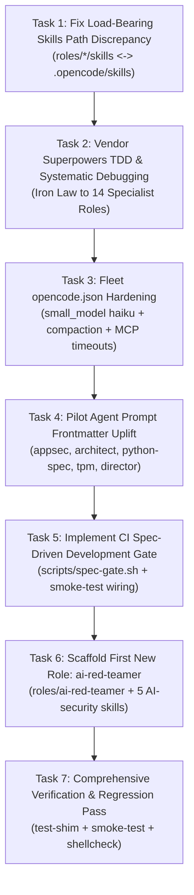

# AUTONOMOUS IMPLEMENTATION MISSION: INTEGRATING RESEARCH EXPANSION (PHASE A)
## Load-Bearing Path Fixes, Superpowers TDD Ingestion, Fleet Config Hardening, SDD Gate & First AI Red-Teamer Role

**Target Codebase**: `/home/john/Projects/Heretek-Crew`  
**Execution Context**: OpenCode v2 Implementation Run  
**Authoritative Source**: [`RESEARCH_EXPANSION_REPORT.md`](file:///home/john/Projects/Heretek-Crew/RESEARCH_EXPANSION_REPORT.md)  
**Primary Deliverables**: Concrete, verified code changes across `roles/`, `scripts/`, and `roles-catalog/`  

---

## 1. Mission Objectives & Invariants

You are tasked with executing **Phase A (Immediate High-ROI Wins & Hardening)** from the 30-day evolutionary roadmap specced in `RESEARCH_EXPANSION_REPORT.md`.

### Strict Operational Invariants (Non-Negotiable)
1. **Zero-Stub Policy**: No placeholder comments (`// TODO`), dummy return values, or empty mock blocks. All files must be functional, robust, and fail-closed.
2. **Strict Version Pinning**: Never use `:latest`, `@latest`, or unpinned package installs.
3. **Least Privilege (PoLP)**: Every `opencode.json` file MUST retain its terminal shell deny tail:
   ```json
   { "action": "shell", "resource": "*", "effect": "deny" }
   ```
4. **Shell Script Standards**: All bash scripts must begin with `set -euo pipefail`, pass `shellcheck` with zero warnings, and support `--dry-run` and `--help`.
5. **Continuous Verification**: All changes must pass `bash scripts/test-shim.sh` and `bash scripts/smoke-test.sh --check-only` without regressions.

---

## 2. Implementation Execution Plan (Phase A)

Execute the following 7 tasks in sequence:



---

### Task 1: Fix the Load-Bearing Skills Path Discrepancy (§10.5)

**Root Cause**: In `roles/*/opencode/opencode.json`, configs declare `"skills": ["/roles/<id>/skills"]`, whereas on-disk skills currently reside at `roles/<id>/.opencode/skills/<skill>/SKILL.md`. Under Paperclip container mounts (`XDG_CONFIG_HOME = "/roles/<id>"`), skills in `.opencode/skills/` may silently fail to discover if `/roles/<id>/skills` does not resolve to the same location.

**Directives**:
1. For every role under `roles/`, ensure that `roles/<role-id>/skills` is a directory or symlink pointing to `.opencode/skills`:
   ```bash
   for role_dir in roles/*; do
     if [ -d "$role_dir/.opencode/skills" ] && [ ! -e "$role_dir/skills" ]; then
       ln -s .opencode/skills "$role_dir/skills"
     fi
   done
   ```
2. In `roles/*/opencode/opencode.json`, verify that `"skills"` array includes both `"/roles/<role-id>/skills"` and `"/roles/<role-id>/.opencode/skills"` (or relative `".opencode/skills"`), ensuring discovery regardless of how OpenCode resolves `XDG_CONFIG_HOME`.
3. Add a check in `scripts/smoke-test.sh` asserting that every role with configured skills has accessible skill directories and valid `SKILL.md` files.

---

### Task 2: Vendor High-Leverage Superpowers Skills (§3.2, §10.3)

Vendor the battle-tested procedural skills from `obra/superpowers` (cached at `/tmp/opencode/superpowers/skills/` or cloned if absent) into the appropriate roles:

1. **Implementer Roles**:
   - Roles: `python-backend-spec`, `ts-node-fullstack`, `go-backend-eng`, `cpp-lowlevel-eng`, `rust-systems-spec`, `java-kotlin-eng`.
   - Vendor Skills:
     - `test-driven-development/SKILL.md` (Enforces the **Iron Law**: no production code without a watched-fail test).
     - `systematic-debugging/SKILL.md` (Enforces 4-phase root-cause investigation before applying code fixes).
   - Target Directory: `roles/<role-id>/.opencode/skills/<skill-name>/SKILL.md`.

2. **Product & Architecture Roles**:
   - Roles: `product-director`, `system-architect`.
   - Vendor Skills:
     - `brainstorming/SKILL.md` (Chunked specification elicitation).
     - `writing-plans/SKILL.md` (Decomposing epics into test-gated task plans).

3. **QA Verification Roles**:
   - Roles: `api-contract-tester`, `e2e-browser-qa`, `release-qa-officer`, `sabotage-qa-tester`.
   - Vendor Skills:
     - `verification-before-completion/SKILL.md` (Evidence-based verification before task completion).
     - `requesting-code-review/SKILL.md` (SHA-pinned code review protocols).

4. **Orchestration Roles**:
   - Roles: `exec-director`, `tpm-scrum-lead`.
   - Vendor Skills:
     - `dispatching-parallel-agents/SKILL.md` (Subagent worktree fan-out).

5. **Charter Updates**:
   - In each touched role, update `roles/<role-id>/AGENTS.md`:
     - Under §5 (Skills Inventory), list the vendored skills.
     - Under §7 (Per-Ticket Workflow), paste the non-negotiable enforcement clause:
       ```markdown
       - Execute implementation steps under the vendored procedure skill(s) (e.g. `.opencode/skills/test-driven-development/SKILL.md`); no production code without a watched-fail test. TDD violations are deleted, not adapted.
       - If any required tool is denied, stop and hand off via assignment — do not attempt to bypass permissions (fail closed).
       ```

---

### Task 3: Fleet `opencode.json` Hardening (P0 Config Upgrades, §5, §10.2)

Audit and patch all `roles/*/opencode/opencode.json` files with upstream best practices:

1. **Small Model Tiering**: Add `"small_model": "anthropic/claude-haiku-4-5"` alongside `"model": "anthropic/claude-sonnet-4-5"`. This routes title generation, summarization, and conversation compaction to Haiku, cutting trivial token costs by ~80%.
2. **Context Compaction Guards**: Add:
   ```json
   "compaction": {
     "auto": true,
     "prune": true,
     "reserved": 10000
   }
   ```
3. **MCP Timeout Protection**: Ensure every entry in `"mcp"."servers"` includes `"timeout": 5000` to prevent unhandled hangs on unresponsive sidecars.
4. **Secret Protection**: Ensure that filesystem permissions explicitly forbid reading `.env` and `*.env.*` secret files.
5. **Deny Tail Integrity**: Confirm that every single `opencode.json` ends with:
   ```json
   { "action": "shell", "resource": "*", "effect": "deny" }
   ```

---

### Task 4: Pilot Role Frontmatter Uplift (§7.3)

Uplift the agent prompt markdown files for the 5 primary anchor roles:
- `roles/appsec-engineer/.opencode/agents/appsec-engineer.md`
- `roles/system-architect/.opencode/agents/system-architect.md`
- `roles/python-backend-spec/.opencode/agents/python-backend-spec.md`
- `roles/tpm-scrum-lead/.opencode/agents/tpm-scrum-lead.md`
- `roles/exec-director/.opencode/agents/exec-director.md`

Transform them from bare text into the high-precision frontmatter contract:

```markdown
---
name: <role-id>
description: PROACTIVELY use for <specific domain responsibilities>. Trigger when <explicit trigger criteria>.
model: anthropic/claude-sonnet-4-5
maxTurns: 30
skills:
  - <preloaded-skill-1>
  - <preloaded-skill-2>
tools:
  - Read
  - Skill
  - <allowed-tool-prefixes>
permissionMode: default
memory: project
---
# <Role Title>
You are the <Role Title> in Heretek-Crew.

## Execution Contract (Non-Negotiable)
You MUST execute tickets by adhering strictly to the relevant procedures in `.opencode/skills/`.
You are forbidden from:
1. Writing production code without a failing test (Iron Law).
2. Leaving stubs, mocks, or `// TODO` placeholders.
3. Bypassing tool denials or modifying files outside your authorized scope.

## Workflow: Ingest -> Plan -> Red -> Green -> Verify -> Handoff
...
```

---

### Task 5: Implement CI Spec-Driven Development Gate (`scripts/spec-gate.sh`, §4.1)

Author a new verification script: `scripts/spec-gate.sh`.

1. **Script Contract**:
   - Must start with `set -euo pipefail`.
   - Must implement `--help` and `--dry-run`.
   - Must pass `shellcheck` with zero warnings.
2. **Logic**:
   - Checks that for any code changes touching `roles/` or source trees, corresponding specification deltas exist under `specs/` or `roles-catalog/`.
   - Verifies that task plans have explicit checkboxes and test acceptance criteria.
   - Exits `0` if specifications and verification criteria are satisfied; exits `1` fail-closed with diagnostic reasons if specification gates are missing.
3. **Wire into CI**:
   - Add a call to `bash scripts/spec-gate.sh --check-only` inside `scripts/smoke-test.sh`.

---

### Task 6: Scaffold First New Specialist Role: `ai-red-teamer` (R1, §8.4)

Address the single largest security blind spot in the fleet: running a 50-agent AI fleet without a dedicated Adversarial AI / LLM Red-Teamer.

1. **Create Role Directory**: `roles/ai-red-teamer/`
2. **Author Charter**: `roles/ai-red-teamer/AGENTS.md`
   - Mission: Red-teaming fleet system prompts, detecting indirect prompt injections, auditing RAG vector pipelines, testing for system prompt leakage, and verifying MCP tool-poisoning defenses (MITRE ATLAS & OWASP LLM Top-10).
   - Writes strictly confined to: `docs/security/ai-redteam/**`.
3. **Author Native Config**: `roles/ai-red-teamer/opencode/opencode.json`
   - Model: `anthropic/claude-sonnet-4-5`, `small_model: anthropic/claude-haiku-4-5`.
   - Permissions: Allow `git status*`, `git diff*`, `garak*`, `pyrit*`, `promptfoo*`.
   - Explicit terminal deny tail: `{ "action": "shell", "resource": "*", "effect": "deny" }`.
   - Symlink or populate `skills/`.
4. **Vendor Initial AI Security Skills**:
   Copy the following skills from `/tmp/opencode/cyber-skills/skills/` into `roles/ai-red-teamer/.opencode/skills/`:
   - `detecting-ai-model-prompt-injection-attacks`
   - `detecting-indirect-prompt-injection`
   - `testing-prompt-injection-in-rag-pipelines`
   - `testing-for-system-prompt-leakage`
   - `auditing-mcp-servers-for-tool-poisoning`
5. **System Prompt**: `roles/ai-red-teamer/.opencode/agents/ai-red-teamer.md` with full frontmatter contract.
6. **Fleet Integration**:
   - Register `ai-red-teamer` in `roles-catalog/07_defensive_security_and_forensics.md` (or proposed Offensive Operations).
   - Update `scripts/smoke-test.sh` to recognize the expanded fleet count (51 roles) or verify cleanly.

---

### Task 7: Comprehensive Verification & Regression Testing

Execute full static and dynamic regression suites:

```bash
# 1. Compatibility Shim Unit Tests (39 assertions)
bash scripts/test-shim.sh

# 2. Static Smoke Test Suite (All 50+ roles, permissions, MCP pins, deny tails)
bash scripts/smoke-test.sh --check-only

# 3. Shell Script Linting
shellcheck scripts/*.sh

# 4. Fleet Seeder Validation (Dry-Run)
bash scripts/seed-50-fleet.sh --dry-run
```

All commands must exit `0` with zero errors and zero warnings.

---

## 3. Hand-off Command for OpenCode

Run the following command to begin execution:

```bash
opencode run --prompt "Read PROMPT_INTEGRATE_RESEARCH_EXPANSION.md and execute Tasks 1 through 7 in order. Fix the skills path discrepancy, vendor Superpowers TDD skills into the implementer and QA roles, apply fleet-wide opencode.json hardening, uplift the 5 pilot role prompts, implement scripts/spec-gate.sh, scaffold the new ai-red-teamer role, and ensure all tests pass cleanly."
```
