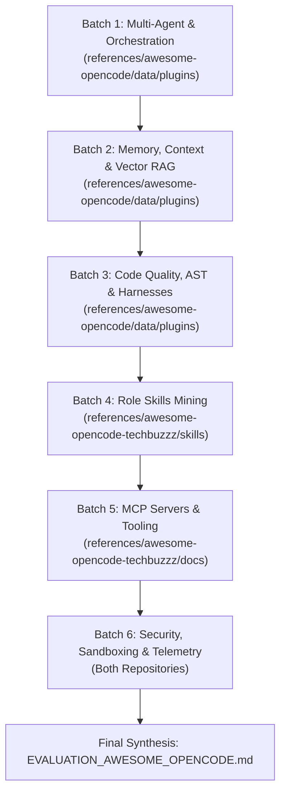

# BATCHED EVALUATION PROMPT FOR OPENCODE
## Ecosystem Mining: `awesome-opencode` & `techbuzzz/awesome-opencode`

**Target Codebase**: `/home/john/Projects/Heretek-Crew`  
**Execution Context**: OpenCode v2 Autonomous Investigation  
**Source Repositories**:
- `references/awesome-opencode/` (Catalog of 130+ plugins, 60+ projects, themes, agents)
- `references/awesome-opencode-techbuzzz/` (Curated skills, MCP quick references, language stacks, multi-agent configs)

---

## 1. Objective & Evaluation Criteria

You are the **Lead Research & Tooling Engineer** for Heretek-Crew. We have cloned two curated OpenCode ecosystem repositories into `references/`.

Your mission is to conduct a **systematic, batched investigation** of these repositories to discover high-value plugins, skills, MCP servers, and configuration patterns that will enhance our 50-agent autonomous factory.

### Evaluation Criteria for Every Candidate Tool
1. **Utility & Value Add**: Does this solve a concrete problem in Heretek-Crew (e.g. multi-agent routing, code repair, memory retention, language mastery for a specific specialist role)?
2. **OpenCode v2 Compatibility**: OpenCode v2 introduced breaking changes from v1. Discard tools that rely on deprecated v1 CLI APIs unless trivial to adapt.
3. **Integration Simplicity**: Can it be deployed via:
   - Global npm install in `docker/Dockerfile`?
   - Procedural skill in `roles/<role-id>/.opencode/skills/<skill-name>/SKILL.md`?
   - Native MCP server in `roles/<role-id>/opencode/opencode.json`?
   - Or composable Docker sidecar in `docker-compose.sidecars.yml`?
4. **Security & PoLP**: Does the tool violate least privilege? Does it leak credentials, require unvetted root binaries, or open unauthenticated network listeners?

---

## 2. Investigation Protocol (6 Sequential Batches)

Investigate the sources in the following 6 sequential batches. Do not attempt to process all items at once; evaluate each batch thoroughly and record your findings before proceeding to the next.



---

### Batch 1: Multi-Agent Orchestration & Subagent Spawning
* **Target Sources**:
  - `references/awesome-opencode/data/plugins/` (search for orchestrator, arise, subagent, swarm, delegation, workflow, multi-agent)
  - `references/awesome-opencode-techbuzzz/README.md` (Section: Orchestration & Multi-Agent)
* **Specific Questions**:
  1. Does `@bluelovers/opencode-arise` or `opencode-agent-identity` offer capabilities we can leverage for subagent spawning and role attribution?
  2. Are there multi-agent orchestration plugins that integrate cleaner than our custom `scripts/dispatch-pipeline.sh`?
  3. Can any tool assist with ticket assignment or inter-agent messaging without web UI friction?
* **Output for Batch 1**: Table of candidates with Verdict (`ADOPT`, `ADAPT`, `REJECT`), Rationale, and Target Heretek-Crew component.

---

### Batch 2: Memory, Context & Knowledge Graphs
* **Target Sources**:
  - `references/awesome-opencode/data/plugins/` (search for memory, context, rag, vector, qdrant, neo4j, sqlite, graph)
  - `references/awesome-opencode-techbuzzz/README.md` (Section: Memory & Context)
* **Specific Questions**:
  1. What plugins exist for long-term agent memory across sessions?
  2. Are there context-compression or smart token-pruning plugins to keep agent contexts lean?
  3. Can any plugin directly interface with our Qdrant or Neo4j sidecars to provide shared semantic memory for the fleet?
* **Output for Batch 2**: Table of candidates with Verdict (`ADOPT`, `ADAPT`, `REJECT`), Rationale, and Target Heretek-Crew component.

---

### Batch 3: Code Quality, AST Editing, Linting & Harnesses
* **Target Sources**:
  - `references/awesome-opencode/data/plugins/` (search for ast, tree-sitter, lint, fix, harness, review, test, tdd)
  - `references/awesome-opencode-techbuzzz/README.md` (Section: Code Quality & Review)
* **Specific Questions**:
  1. How do community code-repair and linting plugins compare against our `@heretek-ai/opencode-harness`?
  2. Are there automated test-generation plugins suitable for `roles/tester` and `roles/release-qa-officer`?
  3. Can any tool enhance our static analysis workflow (`roles/static-analysis-lead`)?
* **Output for Batch 3**: Table of candidates with Verdict (`ADOPT`, `ADAPT`, `REJECT`), Rationale, and Target Heretek-Crew component.

---

### Batch 4: Procedural Skills Mining for the 50 Roles
* **Target Sources**:
  - `references/awesome-opencode-techbuzzz/skills/` (inspect all 10 directories: `code-review`, `dotnet-expert`, `git-flow`, `go-expert`, `nextjs-dev`, `nuxt-dev`, `security-audit`, `tailwind-ui`, `tdd`, `typescript-astro`)
  - `references/awesome-opencode-techbuzzz/docs/skills-quick-reference.md`
* **Specific Questions**:
  1. Map `skills/go-expert/SKILL.md` to `roles/go-backend-eng`. Is it ready for drop-in use?
  2. Map `skills/security-audit/SKILL.md` to `roles/appsec-engineer` and `roles/threat-modeler`.
  3. Map `skills/tdd/SKILL.md` to `roles/tester`.
  4. Map `skills/git-flow/SKILL.md` to `roles/git-drift-coord`.
  5. Map `skills/tailwind-ui/SKILL.md` and `typescript-astro` to `roles/ui-ux-designer` and `roles/ts-node-fullstack`.
  6. Which skills need adaptation or permission alignment before deployment into `roles/<role>/.opencode/skills/`?
* **Output for Batch 4**: Matrix mapping discovered skills to concrete Heretek-Crew role IDs with exact target paths.

---

### Batch 5: MCP Servers & Tooling Infrastructure
* **Target Sources**:
  - `references/awesome-opencode-techbuzzz/docs/mcp-quick-reference.md`
  - `references/awesome-opencode-techbuzzz/README.md` (Section: MCP Servers)
* **Specific Questions**:
  1. Are there high-quality, verified MCP servers for:
     - Database operations (Postgres, Redis) suitable for `roles/dba-specialist`?
     - Cloud & Kubernetes suitable for `roles/k8s-orchestrator` and `roles/cloud-platform-eng`?
     - Documentation search (Context7, DevDocs, Dash)?
  2. Are the package names and execution commands verified on npm/PyPI (no broken packages)?
* **Output for Batch 5**: Ranked list of MCP servers recommended for addition into specific role `opencode.json` files.

---

### Batch 6: Security, Sandboxing & Telemetry
* **Target Sources**:
  - `references/awesome-opencode/data/plugins/` (search for security, audit, permission, mask, telemetry, otel, token)
  - `references/awesome-opencode-techbuzzz/README.md` (Section: Security)
* **Specific Questions**:
  1. Are there secret-masking plugins to prevent API keys or passwords from appearing in execution transcripts?
  2. Are there telemetry plugins compatible with our `jaeger` / `otel-collector` sidecars?
  3. Are there permission-enforcement plugins that provide true argv-level sandboxing beyond OpenCode's string prefix checking?
* **Output for Batch 6**: Table of security/telemetry candidates with integration recommendations.

---

## 3. Required Output Document: `EVALUATION_AWESOME_OPENCODE.md`

Upon completing all 6 batches, write a comprehensive markdown report to `/home/john/Projects/Heretek-Crew/EVALUATION_AWESOME_OPENCODE.md` with the following structure:

```markdown
# OpenCode Ecosystem Mining Report: Recommendations for Heretek-Crew

## 1. Executive Summary & Top 5 High-Impact Adoptions
[The 5 highest-leverage discoveries that should be integrated immediately]

## 2. Batch-by-Batch Evaluation Matrix
### Batch 1: Multi-Agent & Orchestration
### Batch 2: Memory, Context & Knowledge Graphs
### Batch 3: Code Quality, AST & Harnesses
### Batch 4: Procedural Skills for 50 Roles
### Batch 5: MCP Servers & Infrastructure
### Batch 6: Security, Sandboxing & Telemetry

## 3. Immediate Action Plan
[Exact step-by-step instructions to integrate approved items:
 - Skills to copy into roles/<role>/.opencode/skills/
 - Plugins to install in docker/Dockerfile
 - MCP servers to inject into roles/<role>/opencode/opencode.json
 - Compose updates if any supporting sidecars are impacted]
```

---

## 4. Execution Command for OpenCode

Run this prompt inside OpenCode:
```bash
opencode run --prompt "Read PROMPT_INVESTIGATE_AWESOME_OPENCODE.md and execute the 6-batch ecosystem investigation. Inspect references/awesome-opencode and references/awesome-opencode-techbuzzz, evaluate each batch, and write the full report to EVALUATION_AWESOME_OPENCODE.md."
```
