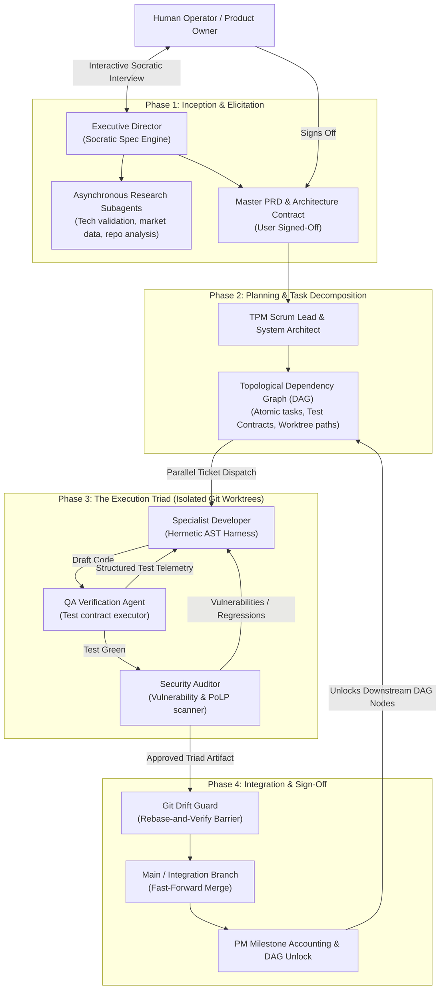

# SPECIFICATION: THE NEXT-GENERATION AUTONOMOUS AI SOFTWARE FACTORY
## Comprehensive Architecture, Lifecycle Protocol & Research Prompts

**Target Codebase**: `/home/john/Projects/Heretek-Crew`  
**Status**: Agreed Specification (via `/grill-me` Architectural Alignment)  
**Authors**: Principal Systems Architect & Heretek-Crew Core Engineering  

---

## 1. High-Level System Architecture

The Next-Generation Autonomous AI Software Factory is a self-hosted, fail-closed platform that transitions from a simple ticket-based agent runner into a **deterministic, multi-agent manufacturing pipeline** capable of taking arbitrary software projects from high-level user vision to production-grade deployment.



---

## 2. The Four-Phase Autonomous Lifecycle

### Phase 1: Inception & Elicitation (User $\leftrightarrow$ Executive Director)
* **Mechanism**: Socratic Spec Engine.
* **Protocol**: The Executive Director runs a targeted interview wave exploring core objectives, edge cases, UX requirements, system scale, and non-functional constraints.
* **Asynchronous Research**: Concurrently dispatches background research subagents to inspect competitive implementations, verify third-party library dependencies, and pull API schemas.
* **Output Gate**: Produces a versioned, unambiguous **Master PRD + Architecture Contract**. Moving to Phase 2 strictly requires explicit user sign-off.

### Phase 2: Planning & Task Decomposition (Director $\rightarrow$ PM & System Architect)
* **Mechanism**: Directed Acyclic Graph (DAG) with Rigid Test Contracts.
* **Protocol**: The TPM Scrum Lead and System Architect analyze the signed-off PRD and decompose it into chronological development phases.
* **Task Atomicity**: Every leaf node in the DAG represents an atomic, single-responsibility module accompanied by:
  1. An explicit **Definition of Done (DoD)**.
  2. A pre-authored **Test-First Contract** (unit/integration test assertions).
  3. An assigned **Git worktree path** (`workspaces/tickets/<id>`).
  4. An explicit list of upstream DAG task dependencies.

### Phase 3: The Execution Triad (Developer $\leftrightarrow$ QA $\leftrightarrow$ Security Auditor)
* **Mechanism**: Adversarial Gatekeeper Protocol.
* **Protocol**:
  1. The task is checked out into an isolated Git worktree.
  2. The Specialist Developer implements the logic inside a hermetic sandbox.
  3. The QA Agent executes automated test suites against the pre-defined test contract.
  4. The Security Auditor scans for vulnerability patterns (OWASP, least-privilege bypasses, secret leaks).
  5. If either QA or Security fails, structured machine-readable telemetry (file path, line number, diagnostic code, expected vs actual) is returned to the Developer.
* **Circuit-Breaker**: If an item fails 3 consecutive iterations, execution halts and escalates to the System Architect / TPM to resolve architectural ambiguity, preventing token-burning doom loops.

### Phase 4: Integration, Drift Guard & Sign-Off (Drift Guard $\rightarrow$ PM)
* **Mechanism**: Rebase-and-Verify Integration Barrier.
* **Protocol**:
  1. Upon triad approval, the Drift Guard (`git-drift-coord`) fetches the latest integration branch and rebases the feature worktree.
  2. A full regression test pass and AST contract stability audit is executed against the rebased tree.
  3. If semantic collisions or regressions occur, the task is kicked back to the Developer with a detailed collision diff.
  4. If green, the worktree is fast-forward merged, diffs and commit histories are archived into `.worktrees/archive/`, and the worktree is detached.
  5. The TPM Scrum Lead verifies milestone progress and unlocks downstream DAG nodes.

---

## 3. Underlying Engineering Pillars

### Pillar A: The Hybrid Orchestration Kernel
* **Paperclip Co-existence**: Paperclip remains the visual WebUI, user dashboard, ticket kanban, and financial accounting layer.
* **Event-Driven Orchestration Kernel**: A dedicated lightweight daemon running alongside Paperclip to manage:
  - Socratic interview state machines.
  - DAG topological scheduling and parallel worktree allocation.
  - Event-driven message routing between the Developer, QA, and Security agents.
  - Drift Guard rebase queues and integration barriers.

### Pillar B: The Hermetic AST & Compiler Feedback Harness
* **Hermetic Sandboxing**: Execution happens in isolated Docker/cgroup environments preventing system pollution.
* **AST-Aware Editing**: Uses `@heretek-ai/opencode-harness` FNV-1a hash anchoring and Tree-sitter symbol transforms rather than brittle naive string matching.
* **Compiler Telemetry Interception**: Intercepts compiler errors, type-checker diagnostics, and test failures, parsing them into structured JSON AST objects before feeding them back to LLM context.
* **Micro-Checkpointing**: Snapshots Git commit state after every successful tool invocation, enabling zero-latency micro-rollbacks when an agent takes a wrong path.

### Pillar C: Tiered Prompt-Cache Architecture
* **Static Prompt-Cache Prefix**: System identity, immutable role boundaries, and negative invariants ("Zero-Stub", "No Mocking", "PoLP Deny Tail") anchored at the very beginning of the prompt to achieve 90% prompt-cache hit rates on Anthropic Claude.
* **On-Demand Procedural Skill Routing**: Rather than injecting hundreds of skills upfront, the Kernel injects only the exact task-relevant `SKILL.md` (e.g. `go-expert`, `security-audit`, `tdd`) dynamically when dispatching the ticket.
* **Rolling AST Checkpoint Summaries**: Conversational chat history is compressed into compact AST state summaries after every milestone, preventing context window bloat and reasoning degradation.

---

## 4. Actionable Research Prompts for OpenCode

Feed these targeted research prompts into OpenCode to investigate the concrete building blocks for each pillar:

### Research Prompt 1: Building the Event-Driven Orchestration Kernel
```bash
opencode run --prompt "Research how to build a lightweight, event-driven DAG orchestration kernel in TypeScript/Go that interfaces with Paperclip's REST API and PostgreSQL database. The kernel must support: 1. Topological sorting of tasks with dependency unlocking. 2. Git worktree lifecycle management (create, rebase, merge, archive). 3. Multi-agent state machines (Developer -> QA -> Security -> Drift Guard). Provide a concrete architecture diagram, state machine schema, and prototype event loop."
```

### Research Prompt 2: Hermetic Compiler Feedback & AST Micro-Rollbacks
```bash
opencode run --prompt "Research how to enhance @heretek-ai/opencode-harness with: 1. Automated compiler error extraction (parsing errors from go, tsc, cargo, and pytest into structured JSON diagnostic objects). 2. Automatic git micro-checkpointing (creating git tree snapshots before tool calls and rolling back automatically on command failure). 3. Integration with tree-sitter for syntax-aware code modifications. Deliver a prototype TypeScript plugin for OpenCode v2."
```

### Research Prompt 3: Socratic Spec Engine & Dynamic Skill Router
```bash
opencode run --prompt "Design the Socratic Spec Engine for Phase 1 Inception: 1. Create a prompt template for the Executive Director that drives interactive user elicitation using structured decision trees. 2. Implement a dynamic skill router that inspects a ticket description and automatically loads only the exact required SKILL.md files into the agent's runtime config, maximizing Anthropic prompt cache hits. Provide full system prompts and configuration examples."
```
