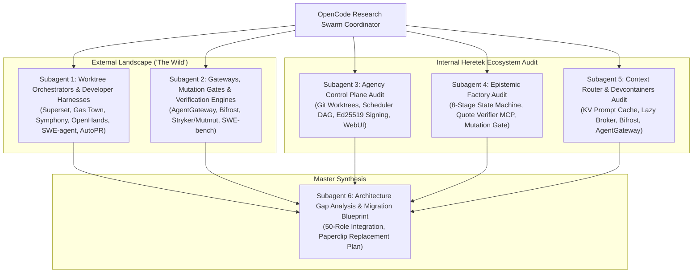

# AUTONOMOUS RESEARCH MISSION: THE WILD & THE HERETEK SOVEREIGN ECOSYSTEM
## Exhaustive Multi-Agent Investigation into Existing Orchestrators, Coding Harnesses & Heretek-AI Side Projects

**Target Workspace**: `/home/john/Projects/Heretek-Crew`  
**Execution Engine**: OpenCode v2 Multi-Subagent Swarm  
**Mission Scope**: External Market Reconnaissance ("The Wild") + Deep Technical Audit of 4 Heretek-AI Companion Repositories  
**Primary Deliverable**: `/home/john/Projects/Heretek-Crew/HERETEK_ECOSYSTEM_INTEGRATION_PLAN.md`  

---

## 1. Executive Intent & Mission Context

Heretek-Crew is currently operating a 50-agent autonomous software engineering fleet configured for Paperclip (`paperclipai/paperclip`), PostgreSQL 17, and OpenCode v2 via a translation shim (`scripts/opencode-shim.sh`).

While Paperclip provides a basic web dashboard and ticket kanban, it suffers from severe architectural limitations:
1. **No native Git worktree isolation** per task, causing file collision risks.
2. **No deterministic AST compiler feedback** or mutation testing verification gates.
3. **No Socratic specification engine** or path-overlap DAG serialization.
4. **No cryptographic Ed25519 commit/diff verification**.
5. **No prompt-cache stabilization or lazy tool brokering**, injecting monolithic schemas that waste context and tokens.

Before designing or rewriting anything from scratch, we have two imperative tasks:
1. **Scour "the wild"**: Investigate what production open-source tools already solve these exact problems.
2. **Audit 4 internal Heretek-AI companion repositories** recently created to address these exact layers:
   - [`Heretek-AI/agency-control-plane`](https://github.com/Heretek-AI/agency-control-plane): Fleet Dispatcher Daemon + High-Fidelity WebUI + OpenCode v2 worker worktrees + Ed25519 diff signing.
   - [`Heretek-AI/epistemic-factory`](https://github.com/Heretek-AI/epistemic-factory): Gated Build Factory enforcing the 8-stage state machine (`GRILL -> RESEARCH -> SPEC -> BUILD_TDD_RED -> BUILD_TDD_GREEN -> GATE_MUTATION -> QA_DUAL_EVAL -> DONE`), Epistemic Quote Verifier MCP server, and mutation testing.
   - [`Heretek-AI/heretek-context-router`](https://github.com/Heretek-AI/heretek-context-router): 4-layer invariant prompt prefix routing (<500 tokens lazy broker via `agentgateway`, prompt caching, and task-scoped skill mounting).
   - [`Heretek-AI/heretek-devcontainers`](https://github.com/Heretek-AI/heretek-devcontainers): Infrastructure layer with 5 Compose profiles, Bifrost LLM gateway, AgentGateway, NATS message bus, and 10-rule static verifier.

---

## 2. Subagent Swarm Topology

Deploy 6 concurrent subagents to investigate both the external open-source landscape and the 4 Heretek-AI repositories:



---

## 3. Subagent Directives & Investigation Briefs

### Subagent 1: Developer-Centric Agent Harnesses in "The Wild"
* **Focus**: How does the open-source community orchestrate parallel coding agents inside Git worktrees without collisions or chaos?
* **Targets to Investigate**:
  1. **Superset (`superset.sh`)**: How does it manage parallel Git worktrees, live terminals, and port collisions for coding agents? What are its architectural primitives?
  2. **Gas Town**: How does its CLI/tmux daemon coordinate 20–30 autonomous agents with a centralized merge queue?
  3. **Symphony**: How does this headless daemon translate issue tickets into autonomous agent coding loops?
  4. **OpenHands (formerly OpenDevin)**: How does its sandboxed runtime handle bash execution, microagents, and event streams?
  5. **Oh My OpenAgent / Sisyphus**: How does the OpenCode plugin ecosystem implement worktree isolation, `@oracle` architecture, and `@librarian` roles?
* **Key Questions to Answer**:
  - Which tools use native Git worktrees vs container isolation vs in-place file mutation?
  - How do they prevent two agents from modifying the same files concurrently?
  - How do they handle merge queues, rebasing, and regression verification?

### Subagent 2: Agent Gateways, Mutation Testing & Verification in "The Wild"
* **Focus**: What off-the-shelf tools exist for AI gateways, prompt caching, tool discovery, and adversarial code verification?
* **Targets to Investigate**:
  1. **AgentGateway (`agentgateway/agentgateway` by Solo.io / Linux Foundation AAIF)**:
     - Architecture, Rust implementation, performance.
     - How does it handle MCP routing, tool-call authorization, session IDs, and AES-256 credential vaulting?
  2. **Bifrost (`maximhq/bifrost`)**:
     - Go-based LLM gateway: latency, adaptive load balancing, automatic provider failover, virtual keys, and semantic caching.
  3. **Mutation Testing in AI Pipelines**:
     - How are tools like Stryker (JS/TS), Mutmut (Python), or cargo-mutants integrated into LLM code-generation loops to detect tests that pass trivially?
     - What are the benchmarks for mutation kill thresholds in automated agent evaluation?
  4. **Prompt Cache Optimization**:
     - Real-world KV-cache hit rate optimizations across Anthropic Claude, OpenAI, and DeepSeek.

### Subagent 3: Deep Audit — `Heretek-AI/agency-control-plane`
* **Local Source**: `references/agency-control-plane` (or cloned from `https://github.com/Heretek-AI/agency-control-plane`)
* **Core Code to Audit**:
  - `dispatcher/src/scheduler.ts`: Pure dependency scheduler with `all_success` / `one_success` policies, fleet caps, and **path-overlap serialization**.
  - `dispatcher/src/worktrees.ts`: Crash-safe Git worktree allocation (`fleet/<task>` branch), base commit pinning, clean teardown.
  - `dispatcher/src/worker-launcher.ts` & `opencode-client.ts`: Spawning `opencode serve --port 0 --hostname 127.0.0.1`, `OPENCODE_DB` isolation, session management, and SSE event streaming (`session.tool.*`).
  - `dispatcher/src/director.ts`: Long-lived Director session parsing Zod-validated ````tasks [...] ```` blocks.
  - `dispatcher/src/human-key.ts` & `approval-tickets.ts`: Ed25519 single-use approval tickets, server-computed `subjectHash` over diff hunks, fail-closed verification.
  - `web/`: Vite/React dark-mode WebUI, CSP headers, live board updates.
  - `dispatcher/src/nats-bridge.ts`: Optional NATS JetStream event bus and KV board mirroring.
* **Key Questions to Answer**:
  - Can `agency-control-plane` immediately replace Paperclip as our fleet orchestrator?
  - How does it handle agent roles? Can our 50 specialist roles from `roles/` run directly in its worktrees?
  - What are the operational requirements (Bun 1.4.2, Git, OpenCode CLI)?

### Subagent 4: Deep Audit — `Heretek-AI/epistemic-factory`
* **Local Source**: `references/epistemic-factory` (or cloned from `https://github.com/Heretek-AI/epistemic-factory`)
* **Core Code to Audit**:
  - `packages/es-core/src/state-machine.ts`: The 8-stage state machine:
    `GRILL -> RESEARCH -> SPEC -> BUILD_TDD_RED -> BUILD_TDD_GREEN -> GATE_MUTATION -> QA_DUAL_EVAL -> DONE (plus HALTED)`.
  - `packages/verifier-mcp/`: Standalone Epistemic Quote & Cache Verifier MCP server. Content-addressed HMAC cache, verbatim quote matching with NFKC normalization.
  - `packages/cli/src/commands/`: `es init`, `es approve`, `es advance`, `es run`, `es audit-research`, `es gate-mutation`.
  - TDD Gate (`gate-tdd`): Enforces that tests FAIL before code is written, then PASS after code is written, locking test manifests to prevent tampering.
  - Mutation Gate (`gate-mutation`): 85% kill threshold mutation testing.
  - Bubblewrap sandbox (`useBwrap: true`) and spend ledger ceiling (`ceilingUSD`).
* **Key Questions to Answer**:
  - Does `epistemic-factory` provide the exact implementation of Phase 3 (Adversarial Gatekeeper Triad)?
  - How easily can its MCP server and CLI be invoked from within OpenCode worker sessions?

### Subagent 5: Deep Audit — `heretek-context-router` & `heretek-devcontainers`
* **Local Source**: `references/heretek-context-router` & `references/heretek-devcontainers`
* **Core Code to Audit**:
  - `heretek-context-router`:
    - `src/prefix-cache.ts` (`assemblePrefixCachedPrompt`): 4-layer invariant prompt prefix routing. How Layers 1 & 2 are frozen for KV-cache reuse.
    - `src/lazy-broker.ts`: `heretek-lazy-broker` MCP stdio server (~240 tokens upfront) exposing `mcp_search_tools`, `mcp_inspect_schema`, `mcp_call_tool`.
    - Role-based authorization gates (`director` and `qa-adversary` read-only) and circuit breakers.
    - `src/skill-mounter.ts`: Skill tree hashing with `.skill-lock.json` and `grimoire.lock`.
  - `heretek-devcontainers`:
    - 5 Compose profiles: `core` (Bifrost, AgentGateway, NATS), `appsec`, `android`, `game`, `research`.
    - Pinned sidecars: Ghidra, Radare2, REA, MDB, Android KVM, ADB, Maestro, Godot, Blender, SearXNG, Crawl4AI, Computer Use Linux.
    - `scripts/verify-stack.ts`: 10 static security rules (`NO_FLOATING_TAGS`, `NO_DOCKER_SOCK`, `LOOPBACK_PORTS_ONLY`, `HARDENED_CAPS`, `SELINUX_VOLUME_LABELS`, etc.).
    - `scripts/heretek-box-ctl.sh`: Operator CLI for profile orchestration.
* **Key Questions to Answer**:
  - How do `heretek-context-router` and `heretek-devcontainers` upgrade our current `docker-compose.sidecars.yml`?
  - How does `agentgateway` connect to the sidecars and `heretek-lazy-broker`?

### Subagent 6: Master Synthesis & The Sovereign Architecture Blueprint
* **Focus**: Unify all findings into an authoritative, fail-closed integration plan.
* **Deliverable Structure (`HERETEK_ECOSYSTEM_INTEGRATION_PLAN.md`)**:
  1. **Comparative Landscape Analysis**: How Heretek's 4 companion repos compare against external tools in the wild (Paperclip, Superset, OpenHands, Gas Town, Symphony).
  2. **The Unified 4-Phase Factory Mapping**:
     - *Phase 1 (Inception)*: Socratic Director (`agency-control-plane`) + Epistemic Research Cache (`epistemic-factory`).
     - *Phase 2 (Decomposition)*: Pure Scheduler DAG with Path-Overlap Serialization (`agency-control-plane`).
     - *Phase 3 (Execution Triad)*: OpenCode v2 Worker Worktrees (`agency-control-plane`) + TDD Red/Green Gates & Mutation Testing (`epistemic-factory`) + Lazy Meta-Tool Routing & Prefix Caching (`heretek-context-router`) + Devcontainer Sidecars (`heretek-devcontainers`).
     - *Phase 4 (Integration & Gate)*: Ed25519 Cryptographic Approval (`agency-control-plane` / `epistemic-factory`) + Fast-Forward Merge Barrier.
  3. **The 50-Role Fleet Ingestion**: How our existing 50 roles from `roles/` map into the unified stack.
  4. **Step-by-Step Transition & Migration Plan**:
     - Wave 1: Deploy Sidecar Foundation (`heretek-devcontainers` Core Profile with Bifrost, AgentGateway, NATS).
     - Wave 2: Mount `heretek-context-router` Lazy Broker & Prompt Cache into OpenCode v2.
     - Wave 3: Run `epistemic-factory` Gates in Task Worktrees.
     - Wave 4: Launch `agency-control-plane` Daemon & WebUI, migrating off Paperclip.

---

## 4. Execution Command for OpenCode

Run the following command to initiate this mission:

```bash
opencode run --prompt "Read PROMPT_RESEARCH_HERETEK_ECOSYSTEM_AND_WILD.md and execute the 6 subagent investigation tracks. Inspect the 4 cloned repositories in references/ (agency-control-plane, epistemic-factory, heretek-context-router, heretek-devcontainers), research external alternatives in the wild, run verification checks, and synthesize the complete findings into HERETEK_ECOSYSTEM_INTEGRATION_PLAN.md."
```
