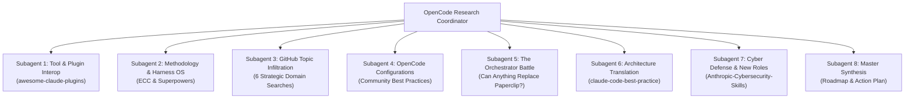

# AUTONOMOUS SUBAGENT RESEARCH & ECOSYSTEM EXPANSION PROMPT
## Multi-Agent Deep Dive into Next-Gen Orchestration, Skills, Harnesses & Agent Architectures

**Target Codebase**: `/home/john/Projects/Heretek-Crew`  
**Execution Context**: OpenCode v2 Multi-Subagent Research Mission  
**Primary Deliverable**: `/home/john/Projects/Heretek-Crew/RESEARCH_EXPANSION_REPORT.md`  

---

## Mission Brief & Executive Intent

Heretek-Crew is a self-hosted, production-grade autonomous software development company running 50 specialist agent roles across 9 departments, backed by Paperclip, OpenCode v2, custom CLI translation shimming, and 10 categories of sidecar services.

Your mission is to **deploy subagents to conduct an exhaustive, rigorous architectural and ecosystem investigation** across 8 critical research tracks. You must inspect live repositories, analyze codebases, evaluate methodologies, stress-test architectural assumptions, and deliver concrete, actionable blueprints for Heretek-Crew.

---

## Subagent Deployment Structure

Deploy your subagents to work concurrently across the following 8 specialized tracks:



---

## Detailed Research Tracks & Directives

### Track 1: Claude Plugins vs OpenCode Interop (`composio-community/awesome-claude-plugins`)
* **Target**: `https://github.com/composio-community/awesome-claude-plugins`
* **Investigation Directives**:
  1. Clone or inspect the repository structure and all listed plugins (Integrations, Frontend, Git, Testing, DevOps, Security).
  2. Determine **which plugins natively support OpenCode** or use standard Model Context Protocol (MCP) servers that can be loaded directly into OpenCode via `opencode.json` (`mcp.servers`).
  3. Identify any plugins that can be ported or wrapped for our 50 specialist roles (e.g. Sentry, GitHub, Linear, Supabase, Vercel, Stagehand).
  4. Filter out hype/low-quality plugins and highlight the top 5 high-leverage production tools.

### Track 2: Agent Methodology & Harness OS (`affaan-m/ECC` & `obra/superpowers`)
* **Targets**:
  - `https://github.com/affaan-m/ECC` (Everything Claude Code / Agent Harness OS)
  - `https://github.com/obra/superpowers` (Superpowers Methodology & Skills)
* **Investigation Directives**:
  1. **ECC (`affaan-m/ECC`)**:
     - Inspect the core architecture: How does it manage skills, hooks, rules, and agents across 7 different harnesses?
     - Evaluate the `ecc-universal` and `ecc-agentshield` npm packages. Can `ecc-agentshield` provide genuine sandboxing or defense-in-depth for OpenCode?
     - Are the cross-tool capability maps and token optimization strategies applicable to Heretek-Crew?
  2. **Superpowers (`obra/superpowers`)**:
     - Inspect how Superpowers natively implements support for OpenCode (see `[OpenCode](#opencode)` in its README).
     - Analyze the *subagent-driven development* workflow: chunked spec elicitation, red/green TDD enforcement, YAGNI/DRY rules.
     - Can the Superpowers skill bundle be imported directly into our `roles/` architecture? Which roles would benefit immediately (`tester`, `programmer`, `product-director`, `system-architect`)?

### Track 3: GitHub Ecosystem Mining Across 6 Strategic Domains
* **Target Topics**:
  1. `spec-driven-development`
  2. `claude-code`
  3. `long-term-memory`
  4. `ai-agents`
  5. `web-scraper`
  6. `workflow-automation`
  7. `code-intelligence`
* **Investigation Directives**:
  1. Use GitHub API / web search / CLI tools to discover the top trending, highest-star, and most production-ready repositories in each of these domains.
  2. In `long-term-memory`: Evaluate modern memory engines (Mem0, Zep, Letta/MemGPT, Cognee) against our existing `qdrant` / `neo4j` / `opencode-mem` stack.
  3. In `spec-driven-development`: Identify tools that enforce strict specification-before-code workflows (analogous to our PRD $\rightarrow$ ADR $\rightarrow$ Decompose pipeline).
  4. In `code-intelligence`: Identify tools providing tree-sitter indexing, symbol resolution, or call-graph tracing that outperform our current MCP graph tools.
  5. Recommend the top 1–2 standout projects from each topic for integration.

### Track 4: OpenCode Best Practices & Real-World User Configurations
* **Investigation Directives**:
  1. Research how leading developers and enterprises configure OpenCode v2 in production.
  2. Audit common `opencode.json` configuration patterns:
     - Model tiering and fallback chains (Sonnet 3.5/3.7, Opus, GPT-4o, DeepSeek-R1, local models).
     - Token cache optimization (`prompt_cache: true`).
     - Global vs per-directory settings.
  3. Identify common operational traps (permission hangs, infinite retry loops, context exhaustion) and the standard defenses against them.

### Track 5: The Big Question — Can Anything Replace Paperclip?
* **Core Dilemma**: Paperclip (`paperclipai/paperclip`) is our current orchestrator, providing a web UI, PostgreSQL schema, ticket tracking, and budget controls. However, it was built around human-in-the-loop interaction rather than purely autonomous, high-throughput inter-agent event-driven orchestration.
* **Investigation Directives**:
  1. Conduct an in-depth comparative benchmark of Paperclip against leading alternatives:
     - **OpenRig (`mvschwarz/openrig`)**: Declarative `RigSpec` YAML topology, pod/seat isolation, native terminal session coordination, cross-harness support. Could we build or adopt an "OpenCode-Rig"?
     - **Temporal.io / Cadence**: Enterprise durable execution, deterministic workflow replay, event sourcing, indestructible state machines.
     - **OpenHands (formerly OpenDevin)**: Sandboxed multi-agent developer platform with event streams and microagents.
     - **CrewAI / AutoGen / LangGraph**: Python-first agent graphs — do they survive in production or degrade into fragile hallucination loops?
     - **Custom Minimalist Event Daemon**: A tailored Go or TypeScript daemon using SQLite/NATS with Git worktrees, native CLI execution, and a zero-latency TUI/Web dashboard.
  2. Deliver an unequivocal architectural recommendation:
     - **Stay with Paperclip** (and patch its adapter),
     - **Migrate to an existing platform** (e.g. OpenRig or Temporal), or
     - **Build a purpose-built Heretek Orchestration Daemon**.
  3. Provide a concrete migration blueprint for the winning option.

### Track 6: Claude Code Best Practices Deep Dive (`shanraisshan/claude-code-best-practice`)
* **Target**: `https://github.com/shanraisshan/claude-code-best-practice`
* **Investigation Directives**:
  1. Inspect the concepts and implementations in this repository:
     - Subagent definitions (`.claude/agents/*.md`)
     - Slash commands (`.claude/commands/*.md`)
     - Procedural skills (`.claude/skills/*/SKILL.md`)
     - Orchestration workflows (e.g. `weather-orchestrator.md`)
     - Lifecycle hooks (`.claude/hooks/`)
     - Auto-memory management (`CLAUDE.md`, `.claude/rules/`, `memory/`)
  2. Analyze how these patterns can be mapped 1:1 into OpenCode v2.
  3. Can we adopt their subagent prompt engineering templates to improve our 50 specialist role system prompts?

### Track 7: Cyber Defense Skills & New Security Agent Roles (`mukul975/Anthropic-Cybersecurity-Skills`)
* **Target**: `https://github.com/mukul975/Anthropic-Cybersecurity-Skills`
* **Investigation Directives**:
  1. Explore the library of **818 production-grade cybersecurity skills** across 34 domains (MITRE ATT&CK, MITRE ATLAS for AI/ML security, MITRE D3FEND, NIST AI RMF).
  2. Identify specific skill clusters to inject into our existing security roles:
     - `roles/appsec-engineer`
     - `roles/threat-modeler`
     - `roles/cloud-sec-auditor`
     - `roles/firmware-sec-analyst`
     - `roles/binary-reverse-eng`
     - `roles/sabotage-qa-tester`
  3. Propose **3–5 brand new elite specialist roles** that Heretek-Crew is currently missing (e.g. AI Red-Teamer / Adversarial Robustness Engineer, Incident Response Commander, Cloud IAM Forensic Auditor, Fraud & Compliance Officer).

### Track 8: Synthesis, Roadmap & Implementation Action Plan
* **Investigation Directives**:
  1. Synthesize all findings into a master report: `/home/john/Projects/Heretek-Crew/RESEARCH_EXPANSION_REPORT.md`.
  2. Structure the report with:
     - Executive Scorecard & Key Recommendations.
     - Detailed Findings for Tracks 1 through 7.
     - **The 30-Day Heretek-Crew Evolutionary Roadmap**: Phased implementation plan categorized into Immediate (Days 1–7), Medium-Term (Days 8–20), and Long-Term (Days 21–30).
     - Concrete code snippets, Dockerfile lines, and role skill mapping tables.

---

## Execution Command for OpenCode

Run this mission in OpenCode:
```bash
opencode run --prompt "Read PROMPT_SUBAGENT_RESEARCH_EXPANSION.md and deploy your subagents to execute all 8 research tracks thoroughly. Write the finalized, exhaustive synthesis report to RESEARCH_EXPANSION_REPORT.md."
```
