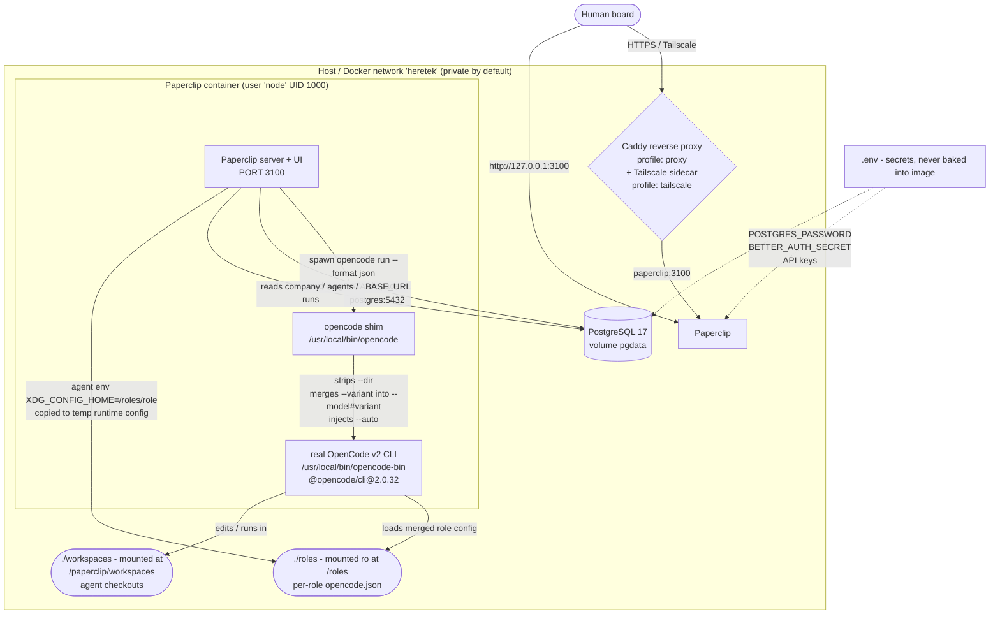

# Heretek-Crew — Paperclip + OpenCode v2 Agent Fleet

Self-hosted Docker Compose stack where [Paperclip](https://github.com/paperclipai/paperclip)
orchestrates a company-style fleet of **OpenCode v2** agents: **51
specialists** across 9 departments (Executive, Game Dev, Web/UI, Language
Engineers, Cloud/SRE, QA, Security/Forensics, Data/AI, Ops) operating as
"Heretek Autonomous Fleet".

All versions are pinned — never `latest` (see [Version upgrades](#version-upgrades)).

| Component | Pin | Where |
|---|---|---|
| Node base image | `node:24-trixie-slim` | `docker/Dockerfile` (inherited from official Paperclip base) |
| PostgreSQL | `postgres:17-alpine` | `docker-compose.yml` |
| OpenCode CLI | `@opencode/cli@2.0.32` | `docker/Dockerfile` (`OPENCODE_CLI_VERSION`) |
| OpenCode client SDK | `@opencode/client@2.0.32` | `docker/Dockerfile` (`OPENCODE_CLIENT_VERSION`) |
| Reverse proxy (optional) | `caddy:2.11.7-alpine` | `docker-compose.yml` |
| Mesh sidecar (optional) | `tailscale/tailscale:v1.104.1` | `docker-compose.yml` |
| Browser/QA MCP | `@executeautomation/playwright-mcp-server@1.0.12` | `roles/e2e-browser-qa`, `roles/ui-ux-designer`, `roles/a11y-specialist` `opencode.json` (+ `fe-perf-eng`, `mobile-web-eng`) |

Paperclip source: extended from the official build in `/tmp/paperclip`
(`paperclipai/paperclip`) — we layer on top of it, we do not fork it.

## Architecture



How a run flows:

1. The board (or a heartbeat) assigns a ticket to an agent. Paperclip's
   `opencode-local` adapter spawns `opencode run --format json …` with the
   agent workspace as the process working directory.
2. The call lands on the **compatibility shim** (`scripts/opencode-shim.sh`,
   installed as `/usr/local/bin/opencode`), which translates the two v1-only
   flags Paperclip still emits and injects `--auto`, then `exec`s the real
   OpenCode v2 binary (`/usr/local/bin/opencode-bin`).
3. OpenCode loads the agent's **role config**: Paperclip copies
   `$XDG_CONFIG_HOME/opencode` (i.e. `/roles/<role>/opencode`) into a temp
   runtime dir, merges runtime providers/permissions, and points OpenCode at
   it — so every role gets isolated tools, MCPs, and skills.
4. JSONL output (`step_start` / `tool_use` / `step_finish` / `text`) streams
   back to Paperclip for transcript, **token/cost accounting**, and session
   resume via `--session`.

## Quickstart

Prerequisites: Docker with the Compose plugin, `make`, `curl`, `python3`.

### Option A: Prebuilt Image (Zero Compilation — Requires a Published Release)

Run the production stack using the official image from GitHub Container
Registry (`ghcr.io/heretek-ai/heretek-crew:1.0.0`). This tag is minted by
the publish workflow when a maintainer pushes the `v1.0.0` git tag
(`git tag v1.0.0 && git push origin v1.0.0` — see
`docker-compose.prebuilt.yml` for the full release/auth flow). No image
tag is published yet: until `docker manifest inspect
ghcr.io/heretek-ai/heretek-crew:1.0.0` resolves (after `docker login
ghcr.io`), use Option B below — `make prebuilt-pull` fails closed with
the registry's own error rather than falling back to anything unpinned.
(`HERETEK_IMAGE` override, if used, must be the exact `:1.0.0` pin or a
digest pin — never `:latest`/floating; see `docker-compose.prebuilt.yml`.)

```bash
# 1. Configure secrets
cp .env.example .env
# Edit .env: set POSTGRES_PASSWORD, BETTER_AUTH_SECRET,
# PAPERCLIP_TOOL_ACTION_SIGNING_SECRET, and at least one model API key.

# 2. Pull prebuilt image from GHCR and start
make prebuilt-pull
make prebuilt-up

# Alternatively, make prebuilt the automatic default for `docker compose up -d`:
#   cp docker-compose.override.yml.example docker-compose.override.yml
#   docker compose pull paperclip && docker compose up -d

# 3. Seed the 51-agent fleet (the only role set)
make seed-50

# 4. Verify
make test
```

### Option B: Build Locally from Source

```bash
# 1. Configure secrets (never commit .env; never bake keys into images)
cp .env.example .env
# Edit .env: set POSTGRES_PASSWORD, BETTER_AUTH_SECRET,
# PAPERCLIP_TOOL_ACTION_SIGNING_SECRET, and at least one model API key.
# Generate secrets with:  openssl rand -base64 48

# 2. Build the official Paperclip base once, then our wave layer on top
docker build -t paperclip:official-local /tmp/paperclip
make build

# 3. Start the stack (postgres + paperclip, UI/API on 127.0.0.1:3100)
make up

# 4. Seed "Heretek Autonomous Fleet" + the 51-agent fleet (idempotent)
make seed-50

# 5. Verify (static checks; live checks run when the stack is up)
make test
```

Open the UI at `http://127.0.0.1:3100`. Follow logs with `make logs`.
Remote access: `docker compose --profile proxy up -d` (Caddy + automatic TLS,
set `PROXY_DOMAIN`), or `docker compose --profile tailscale up -d`
(private mesh; set `TS_AUTHKEY`).

## Operations (`make`)

| Target | What it does |
|---|---|
| `make prebuilt-pull` | Pull official prebuilt image from GHCR without building |
| `make prebuilt-up` | Start stack using prebuilt GHCR image (`docker-compose.prebuilt.yml`) |
| `make prebuilt-config` | Validate merged Compose configuration for prebuilt deployment |
| `make build` | Build the Paperclip + OpenCode v2 image locally (`docker compose build`) |
| `make up` | Start the stack detached |
| `make down` | Stop the stack (named volumes keep all data) |
| `make logs` | Follow `paperclip` service logs |
| `make generate-roles` | Scaffold the 51-agent fleet on disk (`roles/<role-id>/`, idempotent) |
| `make seed-50` | Seed the 51-agent fleet (safe to re-run; patches org-chart/budget drift) |
| `make backup` | `pg_dump` → `backups/backup-YYYYMMDD-HHMMSS.sql.gz`, keeps newest 14 |
| `make restore FILE=backups/…` | Confirm-then-restore a dump (`ON_ERROR_STOP=1`, fail-closed) |
| `make test` | Smoke test: `--check-only` static suite, or full live suite when up |
| `make worktree-create TICKET=…` | Provision isolated Git worktree for ticket (`workspaces/tickets/<id>`) |
| `make worktree-archive TICKET=…` | Archive diff, status, and commits to `.worktrees/archive/` and detach |
| `make pipeline-dry-run PROMPT=…` | Trace 6-phase autonomous factory pipeline (PRD $\rightarrow$ Arch $\rightarrow$ Dev $\rightarrow$ QA $\rightarrow$ Merge) |

Backups live in `backups/` (git-ignored). Retention is configurable via
`BACKUP_DIR` / `BACKUP_RETENTION_COUNT` env vars. Restore is destructive by
design (dumps use `--clean`) and requires typing the database name unless
called with `--yes`.

Smoke test modes (`scripts/smoke-test.sh --help` documents both):

- `--check-only`: no server, daemon, or secrets needed. Checks repo files,
  `docker compose config`, role JSON validity + pins, seed dry-run, shim
  translation matrix, file-creation simulation, `--session` support. Used by
  `make test` in CI gates.
- live (default): everything above plus `pg_isready`, HTTP health at
  `http://127.0.0.1:3100`, and — with `PAPERCLIP_TOKEN` set — a real ticket
  round-trip: assign "Create hello.txt with today's date" to an agent, wait
  for run completion, verify transcript + token/cost accounting + workspace
  file, post a follow-up comment to confirm `--session` resumption.

## Roles

51 specialist roles ship under `roles/<role-id>/`, each with `AGENTS.md`
(charter, chain of command, delegation triggers) and
`opencode/opencode.json` (v2-native permissions, skills, MCPs) — the full
spec lives in `roles-catalog/ROLE_CATALOG_50.md` (see the department table
below). Every role file uses the single fleet permission dialect and ends
in a terminal `shell * deny` tail. Only `exec-director` (30 min) and
`tpm-scrum-lead` (1 h) have timer heartbeats; everyone else wakes on
assignment and on mention. Per-role monthly budgets are exact integer
cents in `scripts/seed-50-fleet.sh` (`role_budget_cents()`), summing to
the $13,000.00 fleet cap (51 roles incl. `ai-red-teamer`, promoted Wave C P1-4).

Wave 3 P1-11 supersession map (the 6 legacy prototype roles were deleted;
use the fleet role instead):

| Deleted prototype | Superseded by (fleet) |
|---|---|
| `director` | `exec-director` (Director / CEO-Delegate) |
| `pm` | `product-director` + `tpm-scrum-lead` |
| `programmer` | Language engineers (roles 19–26, e.g. `ts-node-fullstack`) |
| `tester`, `qa` | `e2e-browser-qa` + `api-contract-tester` + `release-qa-officer` |
| `designer` | `ui-ux-designer` + `design-system-eng` + `brand-copy-spec` |

### Add a new role (or modify one)

1. Copy an existing role as a template:
   `cp -r roles/ts-node-fullstack roles/sre` (or `roles/release-qa-officer`
   for a read-biased role).
2. Edit `roles/sre/opencode/opencode.json`: set `model`, least-privilege
   `permissions` (single fleet dialect, terminal `shell *` deny), `skills`,
   and any `mcp` servers (pin versions, never `latest`).
3. Write `roles/sre/AGENTS.md`: identity/scope, who it reports to, who it may
   delegate to, delegation triggers, non-negotiables, completion protocol.
4. Wire it into `scripts/seed-50-fleet.sh`: extend `ROLE_LIST` and the
   `role_*()` metadata helpers (Paperclip role enum, display name, model,
   budget, timer, `reportsTo` wiring in both dry-run placeholders and pass 2),
   plus `scripts/generate-50-roles.py` if the role belongs in the generator.
5. Validate without a server:
   `./scripts/seed-50-fleet.sh --dry-run` (with the Wave-2 provisioning
   dummies — see `scripts/smoke-test.sh` §4) and
   `./scripts/smoke-test.sh --check-only` (roles are discovered
   dynamically, so the new role is covered automatically).

Per-role isolation needs no image rebuild: `./roles` is mounted read-only at
`/roles` and each agent's adapter config sets `env.XDG_CONFIG_HOME` to
`/roles/<role>`. Re-seed (or update the agent in the UI) to pick up changes.

### Swap models per role

Three levels, cheapest first:

1. **Per role file** — edit the `"model": "provider/model"` string in
   `roles/<role>/opencode/opencode.json` (e.g. `"model": "opencode/gemini-3.8-flash"`),
   then re-seed or update the agent. Variants use the v2 suffix form:
   `"provider/model#variant"` (the shim also auto-merges Paperclip's legacy
   `--variant` flag into this form).
2. **At seed time** — `MODEL_DEFAULT=… MODEL_COORDINATOR=… ./scripts/seed-50-fleet.sh`
   overrides the adapter `model` for all / the three coordination roles
   (`exec-director`, `tpm-scrum-lead`, `system-architect`) without
   touching role files.
3. **Credentials** — provider keys come from `.env`
   (`OPENAI_API_KEY`, `ANTHROPIC_API_KEY`, …); they are injected at runtime,
   never baked into the image.

## 51-agent fleet (`roles-catalog/` → `roles/` → Paperclip)

The repo ships a full **51-specialist enterprise fleet** specified in
`roles-catalog/ROLE_CATALOG_50.md` (plus department modules `01_*.md` …
`09_*.md`) and scaffolded on disk under `roles/<role-id>/` — this IS the
role set (`ls roles/ | wc -l` = 51; the 6-role prototype was removed in
Wave 3 P1-11, see the supersession map above). Each fleet role carries
the same four artifacts: `AGENTS.md`, `opencode/opencode.json`,
`.opencode/agents/<role-id>.md`, and skill packs under
`.opencode/skills/*/SKILL.md`.

### Department breakdown (9 departments, 51 roles)

| Dept | Module | Roles | Count |
|---|---|---|---|
| 1. Executive & Product Management | `01_executive_and_product_management.md` | `exec-director`, `product-director`, `tpm-scrum-lead`, `system-architect`, `tech-docs-lead`, `ux-research-analyst` | 6 |
| 2. Game Development | `02_game_development.md` | `game-systems-dev`, `graphics-shader-eng`, `engine-systems-eng`, `game-ai-dev`, `physics-sim-eng`, `tech-artist-pipeline` | 6 |
| 3. Web & UI/UX Design | `03_web_and_ui_ux_design.md` | `ui-ux-designer`, `design-system-eng`, `a11y-specialist`, `fe-perf-eng`, `mobile-web-eng`, `brand-copy-spec` | 6 |
| 4. Specialized Language Engineers | `04_specialized_language_engineers.md` | `rust-systems-spec`, `go-backend-eng`, `python-backend-spec`, `ts-node-fullstack`, `cpp-lowlevel-eng`, `java-kotlin-eng`, `ios-mobile-spec`, `android-mobile-spec` | 8 |
| 5. Cloud, Platform & SRE | `05_cloud_platform_and_sre.md` | `cloud-platform-eng`, `k8s-orchestrator`, `sre-incident-eng`, `observability-eng`, `dba-specialist`, `cache-streaming-eng` | 6 |
| 6. Quality Assurance & Verification | `06_quality_assurance_and_verification.md` | `e2e-browser-qa`, `api-contract-tester`, `load-stress-tester`, `sabotage-qa-tester`, `static-analysis-lead`, `release-qa-officer` | 6 |
| 7. Defensive Security & Forensics | `07_defensive_security_and_forensics.md` | `appsec-engineer`, `cloud-sec-auditor`, `binary-reverse-eng`, `firmware-sec-analyst`, `threat-modeler`, `compliance-auditor`, `ai-red-teamer` | 7 |
| 8. Data & AI Systems | `08_data_and_ai_systems.md` | `data-pipeline-eng`, `vector-rag-spec`, `mlops-serving-eng`, `analytics-metrics-eng` | 4 |
| 9. Operations & Maintenance | `09_operations_and_maintenance.md` | `dependency-patcher`, `git-drift-coord` | 2 |

Notable specialist wiring (see the catalog for the full spec):
`android-mobile-spec` drives `mobile-mcp` (`@mobile-next/mobile-mcp@0.1.2`)
against a `docker-android` emulator over ADB (`127.0.0.1:5555`);
`binary-reverse-eng` pairs `r2mcp` (Radare2) with filesystem + shell tooling
for evidence-based decompilation (the `morluto/rea` MCP and `opencode-rea`
plugin were removed Wave C P0-5/P1-12 — both unpublished on npm).

### Seeding the fleet

```bash
# 1. Scaffold (or re-scaffold) all 51 role directories from the catalog
make generate-roles            # python3 scripts/generate-50-roles.py (idempotent)

# 2. Preview exactly what would be POSTed — no network calls
bash scripts/seed-50-fleet.sh --dry-run   # 1 company + 51 agent payloads

# 3. Seed "Heretek Autonomous Fleet" + 51 agents into Paperclip (idempotent)
make seed-50                   # bash scripts/seed-50-fleet.sh
```

Model overrides: `MODEL_DEFAULT=…` re-targets all 51 agents,
`MODEL_COORDINATOR=…` re-targets the three coordination roles
(`exec-director`, `tpm-scrum-lead`, `system-architect`); heartbeat
intervals via `TIMER_EXEC_SEC` / `TIMER_TPM_SEC` (defaults 1800 / 3600).

**Budget note — reconciled (Wave 3 P1-1, Wave C P1-4).** The catalog's documented
fleet cap is **$13,000.00 USD** (1,300,000 cents), exactly the sum of the
verbatim per-role table values (verified: `python3` re-sum of both the
catalog `$` column and the seeder's per-role cents table = 1,300,000¢,
n=51 incl. `ai-red-teamer` @ $300 promoted from pending). The seeder uses the per-role catalog values verbatim, prints the
computed total, and emits a `WARNING` only on drift (e.g. via
`FLEET_BUDGET_CAP_CENTS` env override) — it never invents budgets to force
a total. The smoke test asserts total == cap with no `WARNING`, so any
future catalog/seed drift stays visible.

### How Paperclip routes tasks to on-demand specialists

- **Isolation** — every agent is seeded with
  `adapterConfig.env.XDG_CONFIG_HOME=/roles/<role-id>`, so Paperclip's
  `prepareOpenCodeRuntimeConfig` copies that role's `opencode.json` into a
  temp runtime dir, merges credentials/permissions, and hands it to
  OpenCode v2. No image rebuild is needed to change a role: edit
  `roles/<role-id>/`, re-run `make generate-roles` if the change belongs
  in the generator, and re-seed.
- **On-demand wake** — 49 of the 51 roles are seeded with
  `heartbeat.enabled: false, intervalSec: 0, wakeOnAssignment: true,
  wakeOnMention: true`: they consume no idle tokens and wake only when a
  ticket is assigned or they are `@mentioned`. Only `exec-director`
  (1800 s) and `tpm-scrum-lead` (3600 s) run recurring heartbeats.
- **Hierarchy (`reportsTo`)** — `exec-director` answers to the human
  board; `product-director` and `system-architect` report to
  `exec-director`; `tpm-scrum-lead`, `tech-docs-lead`, and
  `ux-research-analyst` report to `product-director`. Game, Web/Design,
  Language, QA, and Ops roles report to `tpm-scrum-lead`; Cloud/SRE,
  Security/Forensics, and Data/AI roles report to `system-architect`.
  Seeding is two-pass (ensure agents, then PATCH `reportsTo` + budgets on
  drift), so `make seed-50` is safe to re-run and heals org-chart drift.

## Version upgrades

| What | Current | Where to change | Notes |
|---|---|---|---|
| OpenCode CLI/client | `2.0.32` | `docker/Dockerfile` `ENV OPENCODE_CLI_VERSION` / `OPENCODE_CLIENT_VERSION` | Bump together; re-run shim + smoke tests (`--dir`/`--variant`/`--auto` behavior may change upstream) |
| Node base | `node:24-trixie-slim` | inherited from official base rebuilt from `/tmp/paperclip` | Rebuild `paperclip:official-local` first |
| PostgreSQL | `postgres:17-alpine` | `docker-compose.yml` `postgres.image` | `make backup` before major bumps; PG data volume may need `pg_upgrade`/dump-restore |
| Caddy | `caddy:2.11.7-alpine` | `docker-compose.yml` `caddy.image` | proxy profile only |
| Tailscale | `tailscale/tailscale:v1.104.1` | `docker-compose.yml` `tailscale.image` | tailscale profile only |
| Playwright MCP | `@executeautomation/playwright-mcp-server@1.0.12` | `roles/e2e-browser-qa`, `roles/ui-ux-designer`, `roles/a11y-specialist`, `roles/fe-perf-eng`, `roles/mobile-web-eng` `opencode.json` | keep all five consumers in sync |

After any bump: `make build && make up && make test` (live), plus
`scripts/test-shim.sh` for the shim matrix.

## Security model

**How unattended runs stay permission-enforced.**
OpenCode v2 non-interactive runs reject tool-approval prompts
(`"This non-interactive run cannot ask the user for permission…"`) unless the
run passes `--auto` or carries an allow-all permissions array. Paperclip drives
agents unattended — there is no human at the approval prompt at 3 AM — so the
shim injects `--auto`, but every seeded agent is created with
`dangerouslySkipPermissions: false` (asserted by the smoke gate): `--auto`
only auto-approves tools the role's `permissions` array explicitly allows,
and every role file ends in a terminal `shell *` deny. Least-privilege is
enforced at the role-config layer plus the resource layer (read-only PG
role, scoped `GITHUB_TOKEN`, read-only kubeconfig — see `AGENTS.md` §4),
never by prefix `shell` allows alone.

**How container isolation compensates.** Auto-approve is only safe inside a
sandbox; this stack provides it:

- **Private networking by default** — the UI/API binds `127.0.0.1:3100`;
  Postgres exposes no host ports at all. Remote access is opt-in via the
  `proxy` (Caddy/TLS) or `tailscale` profiles.
- **Non-root execution** — the Paperclip server and every agent child process
  run as `node` (UID 1000): the entrypoint repairs `/paperclip` ownership as
  root, then `exec gosu node`. (Deliberately no `USER node` in our layer —
  that would silently disable the ownership repair and break first boot.)
- **Restricted volumes** — `./roles` is mounted `:ro`; only
  `./workspaces` and the `paperclip-data` volume are writable, so a rogue run
  cannot rewrite its own role config or escape the data dir.
- **Resource ceilings** — `cpus: 2.0`, `mem_limit: 4g`, `pids_limit: 2048`
  stop a fork-bombing or runaway fleet from starving the host; `tini` reaps
  zombie agent/tool descendants.
- **No baked secrets** — API keys and signing secrets live only in `.env`
  (git-ignored, documented in `.env.example`); images carry versions, not
  credentials. Backups contain database bytes only and stay in git-ignored
  `backups/`.
- **Fail-closed scripts** — seed, backup, restore, and smoke scripts abort on
  unhealthy dependencies, refuse to guess (restore requires `FILE=` plus typed
  confirmation), and restore with `ON_ERROR_STOP=1`.

## Layout

```
.github/workflows/
  docker-publish.yml      multi-arch GHCR publishing pipeline + verification
  ci.yml                  automated fleet & shim static verification gate
docker-compose.yml        postgres + paperclip (+ optional caddy/tailscale profiles)
docker-compose.prebuilt.yml prebuilt GHCR override (build: !reset null)
docker-compose.override.yml.example template for automatic prebuilt image adoption
docker/Dockerfile         official-base extension: OpenCode v2 + shim, pinned
.env.example              secrets template (copy to .env, never commit .env)
Makefile                  build/up/down/logs/seed/backup/restore/test + prebuilt
scripts/
  opencode-shim.sh        v1→v2 CLI translation (--dir/--variant/--auto)
  generate-50-roles.py    50-role disk scaffolding generator (roles/<role-id>/)
  seed-50-fleet.sh        idempotent 51-agent fleet seeder (supports --dry-run)
  spec-gate.sh            spec-driven development gate (PRD/ADR/task deltas in CI)
  backup-db.sh            timestamped pg_dump + retention
  restore-db.sh           confirmed, fail-closed restore
  smoke-test.sh           --check-only static suite + live ticket round-trip
  test-shim.sh            shim unit matrix (39 assertions)
roles/<role>/            AGENTS.md charter + opencode/opencode.json v2 config + skills/
workspaces/               agent checkouts (host-visible, backup-friendly)
backups/                  timestamped dumps (git-ignored)
```

Design notes, verified upstream facts, and the wave-by-wave execution log live
in [`NOTES.md`](NOTES.md). Sovereign architecture and long-term milestones live in
[`ROADMAP_LONG_TERM_GOALS.md`](ROADMAP_LONG_TERM_GOALS.md),
[`HERETEK_ECOSYSTEM_INTEGRATION_PLAN.md`](HERETEK_ECOSYSTEM_INTEGRATION_PLAN.md), and
[`RESEARCH_EXPANSION_REPORT.md`](RESEARCH_EXPANSION_REPORT.md).
