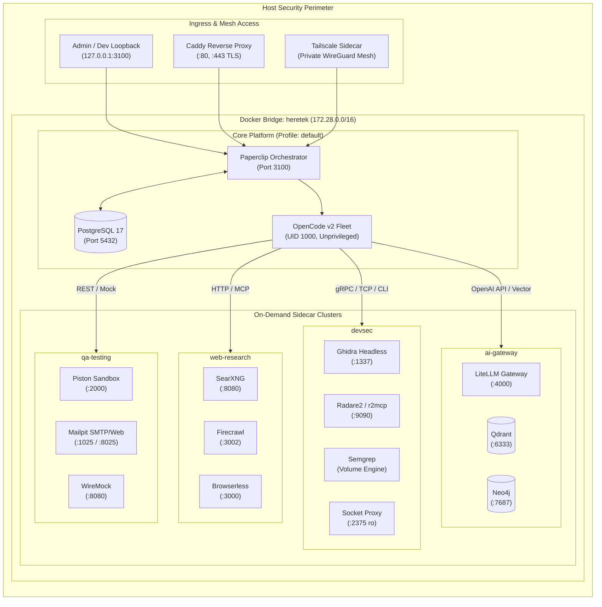

# Executive & Technical Architecture Report: Supporting Software & Sidecars for Autonomous Agent Fleets

**System**: Heretek-Crew (Paperclip Orchestrator + OpenCode v2 Fleet)  
**Author**: Systems Architecture & Infrastructure Group  
**Target Architecture**: Docker Compose (Modular Profiles)  
**Date**: October 2026  

---

## 1. Executive Summary & Strategic Context

Autonomous agent fleets orchestrated by **Paperclip** and powered by **OpenCode v2** represent a paradigm shift from passive code assistants to active, multi-disciplinary engineering organizations. However, production agent fleets face severe operational bottlenecks when required to perform compute-intensive, stateful, or security-sensitive tasks—such as full-DOM browser automation, binary decompilation, AST structural search, adversarial script execution, and semantic memory retrieval.

Historically, organizations attempted to resolve these capability gaps through **monolithic "fat" agent containers**, bundling browsers, Java runtimes, language compilers, and reverse-engineering frameworks directly into the agent image. In practice, this design introduces fatal vulnerabilities: image sizes balloon past 12 GB, build times cripple CI pipelines, memory leaks from headless browsers kill the agent runner process, and executing arbitrary untrusted code inside the agent container risks complete host compromise.

This report establishes a production-grade **Micro-Sidecar Architecture**. By decomposing specialized capabilities into autonomous, containerized sidecars attached to a private internal Docker bridge network (`heretek`), the platform achieves:
1. **Zero Agent Bloat**: The agent runner container remains lean (~1.1 GB, Node.js + OpenCode v2), ensuring fast startup times and rapid rolling updates.
2. **Fine-Grained Resource Quotas**: Compute-heavy workloads (Chromium, Ghidra, Piston) run with hard cgroup CPU and memory boundaries, preventing host starvation.
3. **Hardened Security Boundaries**: Host Docker sockets and file systems are isolated behind proxy firewalls and read-only volume mounts.
4. **Shared Fleet-Wide Caching**: Search indexes, AST graphs, decompiled binaries, and scraped web pages are cached globally, allowing downstream agents (e.g. QA, Reviewer, Refactorer) to reuse compute artifacts.
5. **Modular Profile Orchestration**: Operators spin up only the microservices required for specific missions (`web-research`, `devsec`, `ai-gateway`, `qa-testing`, `observability`).

---

## 2. Platform Architecture & Communication Topology

The Heretek-Crew infrastructure is structured into three distinct security and operational tiers:
- **Tier 1: Ingress & Host Isolation**: The host system remains unexposed to public interfaces. Management interfaces bind to `127.0.0.1` (loopback) or route through a TLS-terminating Caddy reverse proxy or Tailscale mesh sidecar.
- **Tier 2: Orchestration & Fleet Runtime**: Paperclip operates as the central workflow orchestrator and state engine backed by PostgreSQL 17, spawning OpenCode v2 worker processes inside an isolated runtime container.
- **Tier 3: Specialized Sidecar Mesh**: Microservices run as peer containers on the `heretek` bridge network, communicating over HTTP REST, Chrome DevTools Protocol (CDP), Bolt, gRPC, and the Model Context Protocol (MCP).



---

## 3. Evaluative Breakdown by Domain

### 3.1 Domain A: Web Ingestion, Crawling & Search
Autonomous agents rely heavily on up-to-date documentation, API specs, and technical forums.

* **Firecrawl (`ghcr.io/mendableai/firecrawl:v1.17.2`)**:
  - *Architectural Role*: Deep crawling, SPA dynamic rendering, and conversion to LLM-ready clean Markdown.
  - *Evaluation*: Firecrawl decouples headless browser lifecycle management from the agent. It integrates natively via the official `firecrawl-mcp` package.
  - *Footprint*: 120MB idle / 1.8GB peak RAM; requires dedicated Redis (`redis:7.4.1-alpine`).
* **Crawl4AI (`unclecode/crawl4ai:0.9.4`)**:
  - *Architectural Role*: Asynchronous, lightweight crawling with CSS selector extraction and structured JSON generation.
  - *Evaluation*: Lower overhead than Firecrawl for targeted page scraping; ideal for data-mining and doc-harvesting agents.
* **SearXNG (`searxng/searxng:2024.10.16-ac56c663b`)**:
  - *Architectural Role*: Private, rate-limit-free metasearch engine aggregating 70+ engines.
  - *Evaluation*: Eliminates reliance on commercial search APIs (Google/Bing/Tavily) that enforce restrictive quotas and log proprietary agent queries. OpenCode agents consume SearXNG over `@kevinwatt/mcp-server-searxng` or direct JSON API.
* **Gotenberg (`gotenberg/gotenberg:8.15.0`)**:
  - *Architectural Role*: Stateless PDF/HTML generation and conversion engine.
  - *Evaluation*: Allows agents to generate executive reports, convert markdown specs, and render visual diffs without LibreOffice/Chromium installed locally.

### 3.2 Domain B: Resilient & Stealth Browser Automation
Web scrapers and QA automation agents frequently encounter anti-bot protections (Cloudflare, Datadome, Akamai).

* **Browserless Chromium (`ghcr.io/browserless/chromium:v2.24.2`)**:
  - *Architectural Role*: Persistent headless browser daemon pre-configured with stealth plugins, canvas/WebGL fingerprint spoofing, and CDP endpoints.
  - *Evaluation*: OpenCode agents connect over standard WebSocket (`ws://browserless:3000?stealth=true`) using Playwright or `@modelcontextprotocol/server-puppeteer`. Keeps heavy Chromium memory overhead (2–3 GB under concurrency) outside the Paperclip agent runner.
* **mitmproxy (`mitmproxy/mitmproxy:11.0.2`)**:
  - *Architectural Role*: Egress proxy and HTTP traffic auditor.
  - *Evaluation*: Captures all agent-initiated network traffic for security audits, data-exfiltration prevention, and deterministic replay of third-party responses.

### 3.3 Domain C: Defensive Binary Analysis & Reverse Engineering
Specialist agents analyzing compiled firmware, proprietary drivers, or legacy ELF binaries require deep reverse-engineering tooling.

* **Headless Ghidra (`blacktop/ghidra:11.2`)**:
  - *Architectural Role*: NSA Ghidra decompiler running headless scripts and MCP bridges (`bethington/ghidra-mcp`).
  - *Evaluation*: Ghidra's JVM requires 2–4 GB RAM. Isolating it as a sidecar with read-only binary sample mounts prevents decompilation memory spikes from crashing the agent orchestrator.
* **Radare2 / r2mcp (`radare/radare2:6.0.0`)**:
  - *Architectural Role*: High-speed binary triage, disassembly, string extraction, and entropy scanning.
  - *Evaluation*: Sub-second startup time provides immediate triage results before dispatching intensive jobs to Ghidra.

### 3.4 Domain D: Fast Codebase Search, Indexing & AST Analysis
Searching large, multi-repository codebases using plain `grep` in Docker creates severe I/O bottlenecks and high error rates.

* **ast-grep (`ast-grep@0.33.0`)**:
  - *Architectural Role*: Syntactic and structural code search/replacement across 20+ languages based on Concrete Syntax Trees (CST).
  - *Evaluation*: Enables agents to perform structural refactoring (e.g., matching function patterns regardless of whitespace or comment placement) with zero regex hallucinations.
* **Semgrep (`semgrep/semgrep:1.97.0`)**:
  - *Architectural Role*: Local semantic vulnerability scanner enforcing OWASP Top 10 and security best practices.
  - *Evaluation*: Security agents trigger scans against mounted workspaces without transmitting proprietary code to external SaaS vendors.
* **Hound (`ghcr.io/hound-search/hound:v0.6.0`)**:
  - *Architectural Role*: Trigram-indexed code search engine with instant regex querying.
  - *Evaluation*: Keeps search indexes in memory, allowing agents to query millions of lines of code across microservices in under 10 milliseconds.

### 3.5 Domain E: Isolated Execution Sandboxes & Code Runners
Autonomous agents frequently write, test, and execute scripts in Python, Go, Rust, or Bash.

* **Docker Socket Proxy (`tecnativa/docker-socket-proxy:0.3.0`)**:
  - *Architectural Role*: Layer 7 security proxy for the Docker daemon API.
  - *Evaluation*: Raw socket exposure is a catastrophic security vulnerability (trivial root escape). The proxy restricts API calls to `CONTAINERS=1` and `POST=1` while strictly blocking `VOLUMES=0`, `NETWORKS=0`, and `SWARM=0`.
* **Piston (`ghcr.io/engineer-man/piston:v2.0.0`)**:
  - *Architectural Role*: Multi-language execution engine enforcing strict memory limits, cgroups, and execution timeouts (3000ms default).
  - *Evaluation*: Safely executes agent-generated code snippets in an ephemeral sandbox without polluting the agent container filesystem.

### 3.6 Domain F: Agent Memory, Vector Stores & Knowledge Graphs
Agents operating across weeks of sprints must remember architectural conventions, previous bugs, and user preferences.

* **Qdrant Vector Database (`qdrant/qdrant:v1.12.5`)**:
  - *Architectural Role*: Sub-10ms semantic search over project documentation, chunked source files, and conversation memories.
  - *Evaluation*: Rust-based engine with high throughput and low idle memory footprint (~70MB); integrated via `mcp-server-qdrant`.
* **Neo4j Graph Database (`neo4j:5.26.0-community-bullseye`)**:
  - *Architectural Role*: Codebase knowledge graph modeling architectural dependencies, inheritance hierarchies, and API call trees.
  - *Evaluation*: Provides deep relationship querying (Cypher) that vector search cannot achieve; integrated via `neo4j-mcp`.

### 3.7 Domain G: LLM Gateways, Caching & Local Inference
Coordinating 50 agents creates massive model token demand, potential rate limits, and runaway cloud API costs.

* **LiteLLM Proxy (`ghcr.io/berriai/litellm:v1.54.0`)**:
  - *Architectural Role*: OpenAI-compatible load-balancing and routing gateway supporting 100+ LLM providers.
  - *Evaluation*: Enforces hard per-role spend limits, virtual API keys, prompt caching, and automatic fallback routing (e.g. Anthropic Claude 3.7 Sonnet falling back to GPT-4o during rate limits).
* **Ollama (`ollama/ollama:0.5.4`)**:
  - *Architectural Role*: Local inference engine for zero-cost embeddings (`nomic-embed-text`) and routine utility tasks.
  - *Evaluation*: Relieves external API quotas for high-frequency, low-complexity operations.

### 3.8 Domain H: Developer Testing, Mocking & Observability
Agents must verify end-to-end functionality before marking tasks complete.

* **Mailpit (`axllent/mailpit:v1.21.8`)**:
  - *Architectural Role*: Catch-all mock SMTP server and REST inspection API.
  - *Evaluation*: Enables QA agents to test authentication flows, password resets, and notifications without risk of sending real emails.
* **MinIO (`minio/minio:RELEASE.2024-11-07T00-52-20Z`)**:
  - *Architectural Role*: S3-compatible local object storage.
  - *Evaluation*: Hosts agent build artifacts, screenshots, and logs using standard AWS SDKs.
* **WireMock (`wiremock/wiremock:3.10.0-alpine`)**:
  - *Architectural Role*: Configurable HTTP mock server for simulating third-party APIs (Stripe, GitHub, Salesforce).
  - *Evaluation*: Supports stateful scenarios, fault injection (HTTP 500/429), and response templating.
* **OpenTelemetry & Jaeger (`jaegertracing/all-in-one:1.63.0`)**:
  - *Architectural Role*: Distributed tracing sidecar tracking token consumption, latency, and multi-agent call trees.
  - *Evaluation*: Visualizes bottlenecks when agents delegate tasks across subagent swarms.

---

## 4. Hardware Sizing & Compose Profile Budgeting

To ensure the fleet runs efficiently on hardware ranging from local workstations to cloud servers, the architecture is partitioned into **Docker Compose Profiles**:

| Profile Tag | Target Services | Idle RAM | Peak RAM | Target Hardware Spec |
| :--- | :--- | :--- | :--- | :--- |
| **`default` / `core`** | `paperclip`, `postgres`, `docker-socket-proxy` | 1.1 GB | 4.0 GB | 4 vCPU, 8 GB RAM (Dev Laptop) |
| **`web-research`** | `searxng`, `firecrawl`, `browserless`, `gotenberg` | 1.8 GB | 6.5 GB | 8 vCPU, 16 GB RAM (Workstation) |
| **`devsec`** | `ghidra`, `radare2`, `semgrep`, `hound` | 2.5 GB | 8.0 GB | 8 vCPU, 16 GB RAM (Workstation) |
| **`ai-gateway`** | `litellm`, `qdrant`, `neo4j`, `ollama` | 2.2 GB | 12.0 GB | 16 vCPU, 32 GB RAM (Dedicated Server) |
| **`qa-testing`** | `piston`, `mailpit`, `wiremock`, `minio` | 1.5 GB | 5.5 GB | 8 vCPU, 16 GB RAM (Workstation) |
| **`observability`** | `jaeger`, `otel-collector` | 0.8 GB | 2.0 GB | 4 vCPU, 8 GB RAM (Any Node) |

> [!TIP]
> Use targeted profile flags to start only what is required:
> ```bash
> docker compose -f docker-compose.yml -f docker-compose.sidecars.yml --profile web-research --profile qa-testing up -d
> ```

---

## 5. Security Posture & Threat Mitigation

The autonomous execution of arbitrary code and web crawling introduces significant risk vectors. The sidecar architecture implements defense-in-depth across four layers:

```
[Threat Vector: Agent Code Escape] ──► [Mitigation: Piston Sandbox / gVisor cgroups]
[Threat Vector: Host Daemon Hijack] ──► [Mitigation: Docker Socket Proxy (POST/VOLUMES disabled)]
[Threat Vector: Malicious Payload]   ──► [Mitigation: Read-Only Workspace Mounts (:ro)]
[Threat Vector: Data Exfiltration]   ──► [Mitigation: mitmproxy Audited Egress / Loopback Bindings]
```

1. **Daemon Shielding**: Agents never mount `/var/run/docker.sock`. All Docker interactions route through `docker-socket-proxy:2375`, which rejects volume mounting, host networking, and root elevation requests.
2. **Read-Only Code Checkouts**: When security analysis tools (Ghidra, Radare2, Semgrep) inspect user checkouts or binaries, the volume is mounted read-only (`./workspaces:/samples:ro`). Analysis artifacts are written to dedicated ephemeral scratch volumes.
3. **Loopback-Bound Admin UIs**: All administrative web dashboards (Jaeger :16686, Mailpit :8025, SearXNG :8888, MinIO Console :9001, WireMock :8089) strictly bind to `127.0.0.1`. Remote access must traverse Caddy reverse proxy with mutual TLS or Tailscale access controls.
4. **Unprivileged Container Execution**: The OpenCode runner and Paperclip process run as unprivileged `node` user (UID 1000, GID 1000). Root capabilities are dropped across all sidecar definitions (`cap_drop: ["ALL"]`).

---

## 6. Architectural Decision Records (ADRs)

### ADR-001: Sidecar Microservices vs. Monolithic Agent Containers
* **Status**: Accepted
* **Context**: Installing Chromium, Ghidra, compilers, and database runtimes inside the OpenCode container caused image sizes to exceed 12 GB, resulting in frequent memory-exhaustion crashes.
* **Decision**: Decompose all auxiliary capabilities into independent Docker Compose sidecars communicating over the internal bridge network (`heretek`).
* **Consequences**: Minimal agent base image (~1.1 GB); zero downtime during sidecar upgrades; independent CPU and memory quota enforcement.

### ADR-002: Docker Socket Proxy for Host Daemon Protection
* **Status**: Accepted
* **Context**: Agents performing integration tests require Docker orchestration capabilities, but exposing the host Docker socket grants root host access.
* **Decision**: Deploy `tecnativa/docker-socket-proxy:0.3.0` as an API firewall, explicitly whitelisting container operations while blocking volumes, networks, and host mounts.
* **Consequences**: Completely closes the container-escape threat vector while maintaining agent CI/CD capabilities.

### ADR-003: LiteLLM as Centralized Model Gateway
* **Status**: Accepted
* **Context**: 50 concurrent agents calling diverse LLM providers caused frequent rate-limit failures, high cloud spend, and fractured token accounting.
* **Decision**: Route all agent LLM calls through `litellm` backed by PostgreSQL.
* **Consequences**: Fleet-wide spend caps, automatic failover between Anthropic and OpenAI, and prompt-level caching across identical subagent requests.

### ADR-004: Standardizing on Model Context Protocol (MCP) for Tool Integration
* **Status**: Accepted
* **Context**: Agents require a uniform protocol to discover and execute tools across diverse sidecars (Firecrawl, SearXNG, Qdrant, Neo4j, Ghidra, Puppeteer).
* **Decision**: Adopt the open Model Context Protocol (MCP) as the primary tool interface in OpenCode v2's `opencode.json`, with HTTP REST as a secondary fallback.
* **Consequences**: Standardized tool schemas, automated capability discovery, and seamless role-based tool assignment.

---

## 7. Deliverable References

- **Full Specification & Tool Registry**: [SUPPORTING_SERVICES.md](file:///home/john/Projects/Heretek-Crew/SUPPORTING_SERVICES.md)
- **Validated Multi-Service Compose File**: [docker-compose.sidecars.yml](file:///home/john/Projects/Heretek-Crew/docker-compose.sidecars.yml)
- **Paperclip Core Stack**: [docker-compose.yml](file:///home/john/Projects/Heretek-Crew/docker-compose.yml)
- **OpenCode v2 Shim & Integration**: [scripts/opencode-shim.sh](file:///home/john/Projects/Heretek-Crew/scripts/opencode-shim.sh)
