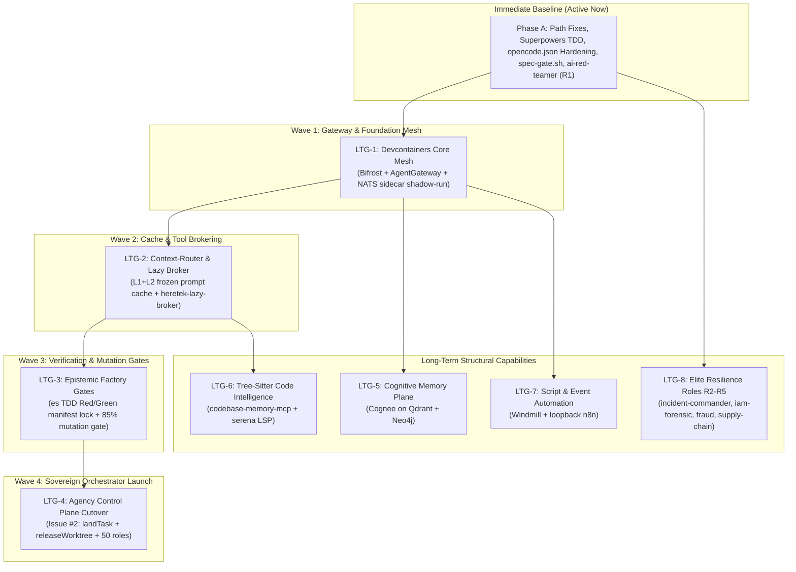

# Long-Term Goals & Sovereign Factory Roadmap

**Document Status**: Official Fleet Strategic Backlog  
**Target Codebase**: `/home/john/Projects/Heretek-Crew`  
**Governing Documents**: [`HERETEK_ECOSYSTEM_INTEGRATION_PLAN.md`](file:///home/john/Projects/Heretek-Crew/HERETEK_ECOSYSTEM_INTEGRATION_PLAN.md), [`RESEARCH_EXPANSION_REPORT.md`](file:///home/john/Projects/Heretek-Crew/RESEARCH_EXPANSION_REPORT.md), [`PROMPT_NEXTGEN_AI_FACTORY_SPEC.md`](file:///home/john/Projects/Heretek-Crew/PROMPT_NEXTGEN_AI_FACTORY_SPEC.md)  
**External Issue Tracking**: [`Heretek-AI/agency-control-plane#2`](https://github.com/Heretek-AI/agency-control-plane/issues/2)  

---

## 1. Executive Roadmap Overview

This roadmap defines the **8 Strategic Long-Term Goals (LTGs)** that transition Heretek-Crew from a ticket-driven agent runner (Paperclip + OpenCode v2) into a **fully sovereign, deterministic, multi-agent AI software factory**.

Each goal is specified with concrete entry points, operational invariants, verification gates, and dependencies.

---

## 2. Detailed Goal Specifications

### LTG-1: Devcontainers Core Mesh & Dual-Gateway Shadow Run
* **Primary Objective**: Deploy the hardened `heretek-devcontainers` Core Profile alongside Paperclip and shadow-compare Bifrost against LiteLLM.
* **Scope & Components**:
  1. Initialize `heretek-devcontainers/compose/core.yml`:
     - `bifrost:v2.3.0` (internal `:8080`, not exposed to host).
     - `agentgateway:v1.6.0` (loopback `127.0.0.1:3000`).
     - `nats:2.15.1-alpine` (`:4222`, `:8222`).
  2. Implement Shadow-Comparison:
     - Run Bifrost and LiteLLM (`docker-compose.sidecars.yml:541-563`) concurrently.
     - Replay representative production agent prompts and record empirical p95 latency, failover reliability, and cost.
     - Do not decommission LiteLLM until local benchmark proves parity or superiority.
  3. Author AgentGateway CEL Policies:
     - Enforce `mcpAuthorization` rules: `mdb` and `gui` restricted to admin keys; enforce strict per-target isolation.
  4. Memory Plane Invariant:
     - Retain `qdrant:v1.19.2` and `neo4j:5.26.32-community-trixie` as authoritative sidecars (R-5).
* **Acceptance Gate**:
  - `bash references/heretek-devcontainers/scripts/accept/wave-1.sh` exits 0.
  - `docker compose --profile core config` validates cleanly with zero floating tags.
  - Root `make test` retains 39/39 passing assertions.

---

### LTG-2: Context-Router, Invariant Prompt Caching & Lazy Tool Broker
* **Primary Objective**: Drop agent token consumption by ~80% and cap tool definition context at <240 tokens upfront.
* **Scope & Components**:
  1. Bake `heretek-lazy-broker` into the production container:
     - Compile and link `heretek-lazy-broker` stdio binary into `/usr/local/bin/heretek-lazy-broker`.
     - Register `mcp.servers.heretek-lazy-broker` in all role `opencode.json` files with `HERETEK_GATEWAY_URL=http://127.0.0.1:3000`.
  2. Deploy 4-Layer Invariant Prompt Prefix:
     - Call `assemblePrefixCachedPrompt({ role, workspaceRoot, activeProfile })`.
     - Freeze Layers 1 & 2 (Negative Invariants, System Identity) byte-for-byte across all roles.
     - Place provider cache breakpoints to guarantee 90%+ prompt-cache hits on Claude Sonnet 4.5.
  3. Drift Reconciliation:
     - Reconcile `session_affinity` spec vs. implementation.
     - Maintain direct SearXNG scraping until the brokered proxy path is verified.
* **Acceptance Gate**:
  - Prompt tokens for initial tool loading verified at $\le 240$ tokens upfront.
  - Anthropic prompt cache hit rate verified above 85% in production logs.
  - `bash scripts/smoke-test.sh --check-only` passes all role configurations.

---

### LTG-3: Epistemic Factory Quality Gates & TDD Manifest Locking
* **Primary Objective**: Enforce the 8-state machine, TDD red/green gates, and 85% mutation kill thresholds inside task worktrees.
* **Scope & Components**:
  1. Vendor Runtime Tooling:
     - Install `es` CLI (`@heretek-ai/es-cli@3.0.0`) on `PATH` in the container.
     - Register `packages/epistemic-verifier-mcp` as a local stdio MCP server for research verification.
  2. Worktree Execution Lifecycle:
     - `es init --dir <worktree>` on task creation.
     - `BUILD_TDD_RED`: Enforces failing test creation before production code can be written. Test manifest is cryptographically locked (`run.json`).
     - `BUILD_TDD_GREEN`: Implementation code passes the pre-locked tests. Any modification or deletion of test assertions triggers anti-cheat fail-closed `HALTED`.
     - `GATE_MUTATION`: Execute `es gate-mutation --dir <worktree> --files <diff-files> -- <test-cmd>`. Start with `break:60` and ratchet to `85%` kill threshold.
  3. Evidence Integrity:
     - Require research claims to cite cached sources using `[VERIFIED: sha256:<hash> "quote"]` validated with NFKC normalization.
* **Acceptance Gate**:
  - 5 pilot roles (`api-contract-tester`, `dba-specialist`, `k8s-orchestrator`, `exec-director`, `tpm-scrum-lead`) successfully ship gated tasks with valid `.factory/approvals/` records.
  - Mutation survivor feedback loop demonstrates automated test-case refinement.

---

### LTG-4: Agency Control Plane Cutover & Sovereign Orchestrator Launch
* **Primary Objective**: Resolve Issue #2 in `Heretek-AI/agency-control-plane` and transition off Paperclip to the native Git-worktree orchestrator.
* **Scope & Components**:
  1. Resolve G-1 (`landTask()` Dead Code):
     - In `dispatcher/src/server.ts`, wire `handleSign` APPROVE path to call `landTask({ repoDir, landingRoot, taskId, missionId })`.
     - Execute fast-forward / `--no-ff` merge onto `fleet/integration/<missionId>` inside throwaway landing worktree.
     - Roll back atomically on pre/post-verification failures; keep task in `waitingHuman` on merge conflict with conflicting files listed.
  2. Resolve G-2 (Worktree Leak):
     - Wire `releaseWorktree()` to run on terminal states (`done`, `failed`, `cancelled`), anchoring salvage references under `refs/salvage/<taskId>`.
  3. Resolve G-3 (50-Role Ingestion):
     - Map `task.expert` to `roles/<role-id>/`.
     - Inject per-role system prompts and `AGENTS.md` boundaries into `taskPrompt()`.
     - Copy role `opencode.json` into worktree `.opencode/opencode.json` and set `XDG_CONFIG_HOME=/roles/<expert>`.
     - Enforce per-expert concurrency limits in scheduler.
  4. Resolve G-4 & G-5:
     - Consume quota dispositions in launcher to dynamically adjust model tiers on fallback.
     - Pin all dependencies in `dispatcher/package.json` and `web/package.json` exact (zero floating ranges).
  5. Cutover:
     - Dual-run on pilot missions; migrate heartbeat roles (`exec-director`, `tpm-scrum-lead`) last.
* **Acceptance Gate**:
  - 2-task E2E test passes in `agency-control-plane` (disjoint paths running in parallel, overlapping paths serialized, both landing onto `fleet/integration/<mission>`).
  - Ed25519 signature verified on landed commits against pinned `human.pub`.
  - Paperclip decommission recorded in `NOTES.md`.

---

### LTG-5: Cognitive Memory Plane (Cognee on Qdrant + Neo4j)
* **Primary Objective**: Deploy self-hosted cognitive memory layer providing entity resolution and temporal knowledge graphs without external SaaS egress.
* **Scope & Components**:
  1. Deploy `topoteretes/cognee` as a pinned sidecar service in Compose:
     - Wire `COGNEE_VECTOR_DB=qdrant:6333` and `COGNEE_GRAPH_DB=bolt://neo4j:7687`.
     - No external API keys or SaaS dependencies (zero-egress posture).
  2. Implement MCP Bridge:
     - Expose `memory_store`, `memory_search`, `memory_trace_entity` MCP tools.
     - Scope memory access per role and per mission.
  3. Automated Decay & Hygiene:
     - Deploy nightly cron job (`scripts/memory-decay.sh`) to prune transient facts, resolve entity conflicts, and decay stale observation weights.
  4. Pilot Mem0 OSS:
     - Conduct a head-to-head recall accuracy benchmark (LOCOMO benchmark) on fleet runbooks between Cognee and Mem0 OSS.
* **Acceptance Gate**:
  - Roles accurately recall cross-ticket architectural decisions and schema changes across 10+ consecutive tasks.
  - Zero external network packets emitted during memory operations (verified via `mitmproxy` logs).

---

### LTG-6: Tree-Sitter Persistent Code Intelligence (Codebase-Memory + Serena)
* **Primary Objective**: Provide persistent call-graph tracing, symbol resolution, and safe LSP refactoring across 162 languages.
* **Scope & Components**:
  1. Deploy `DeusData/codebase-memory-mcp` sidecar:
     - Run inside `devsec` profile with read-only volume mounts (`./workspaces:/src:ro`).
     - Persistent C/tree-sitter SQLite knowledge graph.
     - Expose `resolve_symbol`, `call_graph`, `dependents`, and `blast_radius` tools.
  2. Deploy `oraios/serena`:
     - Scope to programmer and refactorer roles for safe LSP-backed semantic edits (symbol renames, signature changes).
  3. Integrate `tirth8205/code-review-graph`:
     - Add code graph blast-radius analysis to the automated QA pipeline (`semgrep scan` $\rightarrow$ graph blast-radius $\rightarrow$ SARIF report).
* **Acceptance Gate**:
  - Codebase exploration token usage benchmarked and proven to drop by $\ge 70\%$ compared to naive file reading.
  - AppSec reachability audits cite verified `call_graph` traces for all High/Critical findings.

---

### LTG-7: Script Workflow & Event Automation (Windmill + n8n)
* **Primary Objective**: Convert manual operational scripts into audited, versioned workflows with scheduled digests and event webhooks.
* **Scope & Components**:
  1. Deploy `windmill` Sidecar:
     - Import `scripts/backup-db.sh`, `scripts/seed-50-fleet.sh --dry-run`, `scripts/smoke-test.sh --check-only`, and `scripts/spec-gate.sh` as versioned Python/Bash steps.
     - Provide WebUI dashboard and operator execution logs.
  2. Deploy `n8n` Sidecar:
     - Bind strictly to loopback (`127.0.0.1:5678`).
     - Route scheduled operational digests, backup retention monitors, and webhook integrations (Slack/Discord alerts).
     - Wire into WireMock and Mailpit test fixtures for automated integration verification.
  3. Security Confinement:
     - Connect both services through `docker-socket-proxy:2375` with strict read-only and unprivileged constraints.
* **Acceptance Gate**:
  - Database backups and static smoke checks run on automated cron schedules with cryptographic hashes logged.
  - Zero unauthorized container-socket actions permitted by `docker-socket-proxy`.

---

### LTG-8: Fleet Expansion — 4 Remaining Cyber & Resilience Roles (R2–R5)
* **Primary Objective**: Carve the new **Offensive & Resilience Operations** department and scaffold the 4 remaining specialized cyber defense roles.
* **Scope & Components**:
  1. Scaffold Roles:
     - **R2: `incident-commander`**: DFIR, active breach containment, Plaso timelines, Hayabusa forensic analysis, Volatility memory triage. Writes confined to `docs/security/incident/**`.
     - **R3: `cloud-iam-forensic-auditor`**: Runtime cloud compromise detection, stolen credential tracking, lateral movement, GuardDuty response. Writes confined to `docs/security/cloud-forensics/**`.
     - **R4: `fraud-abuse-officer`**: MITRE F3 (Fight Fraud), BEC detection, honeytoken management, QR/phishing defense. Sits in Governance/Compliance. Writes confined to `docs/security/fraud/**`.
     - **R5: `supply-chain-crypto-steward`**: SBOM generation, Sigstore signing, in-toto attestation, Post-Quantum Cryptography (PQC) migration. Writes confined to `docs/compliance/supply-chain/**`.
  2. Skill Ingestion:
     - Vendor 10–14 verified skills from `/tmp/opencode/cyber-skills/skills/` into each role's `.opencode/skills/`.
  3. Containment & RoE:
     - Ensure offensive/dual-use skills remain strictly quarantined to `sabotage-qa-tester` and `ai-red-teamer`.
     - Assert via `smoke-test.sh` that no offensive red-team skills leak into defensive roles.
* **Acceptance Gate**:
  - Fleet headcount expands from 51 to 55 roles cleanly.
  - Every new role passes least-privilege static verification with terminal shell deny tails.
  - Seed script dry-run succeeds with updated budget allocations.

---

## 3. Dependency & Precedence Matrix

| Goal | Target Profile | Pre-requisites | Blocks |
|---|---|---|---|
| **LTG-1** | Devcontainers Core | Docker & Compose installed | LTG-2, LTG-5, LTG-7 |
| **LTG-2** | Context-Router | LTG-1 (AgentGateway live) | LTG-3, LTG-6 |
| **LTG-3** | Epistemic Factory | LTG-2 (Prefix cache active) | LTG-4 |
| **LTG-4** | Agency Control Plane | LTG-3 + Issue #2 closed (G-1 through G-5) | Paperclip Decommission |
| **LTG-5** | Memory Plane | LTG-1 (Core mesh active) | Continuous fleet learning |
| **LTG-6** | Code Intelligence | LTG-2 (Broker active) | AST refactoring pipelines |
| **LTG-7** | Script Automation | LTG-1 (Core mesh active) | Automated ops digests |
| **LTG-8** | Cyber Roles (R2–R5) | Phase A (`ai-red-teamer` R1 live) | Department restructuring |
